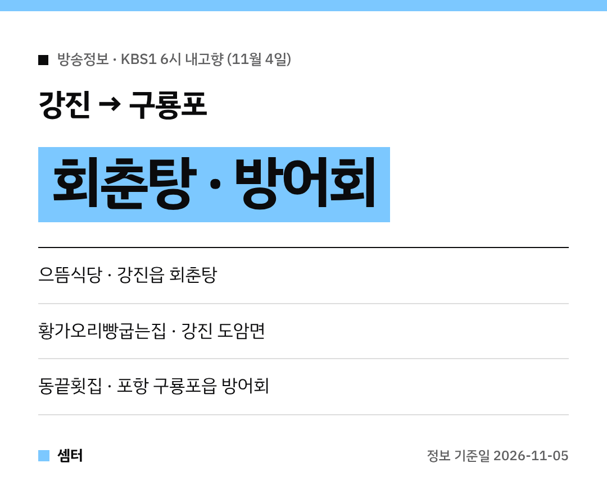

날이 확 추워졌죠~ 이럴 땐 뜨끈한 보양식이랑 제철 회가 딱이에요!
11월 4일 KBS1 '6시 내고향'에 강진 회춘탕집이랑 구룡포 방어회집이 나왔답니다 🐟

## 강진읍 으뜸식당 회춘탕
이날 하이라이트는 전남 강진읍의 회춘탕 식당이었어요.
가게 이름은 **으뜸식당**이에요.

먹으면 기운이 불끈 난다는 회춘탕을 집중해서 보여 줬대요!
가기 전에 전화로 영업 여부를 먼저 물어보면 마음 편해요.

[📍 네이버 지도에서 으뜸식당 보기](https://map.naver.com/p/search/%EA%B0%95%EC%A7%84%20%EC%9C%BC%EB%9C%B8%EC%8B%9D%EB%8B%B9)

## 강진 여행 코스: 생태공원 · 시장 · 황가오리빵
강진 편에서는 **강진만생태공원**과 **강진오감통시장**도 같이 나왔어요.
갈대 보면서 걷고, 시장 구경하고, 회춘탕으로 마무리하면 하루 코스 완성이에요~

간식은 도암면 **황가오리빵굽는집**의 황가오리빵이에요.
여행길 간식으로 하나씩 챙기기 좋겠죠 😆

[📍 네이버 지도에서 강진만생태공원 보기](https://map.naver.com/p/search/%EA%B0%95%EC%A7%84%EB%A7%8C%EC%83%9D%ED%83%9C%EA%B3%B5%EC%9B%90)
[📍 네이버 지도에서 강진오감통시장 보기](https://map.naver.com/p/search/%EA%B0%95%EC%A7%84%EC%98%A4%EA%B0%90%ED%86%B5%EC%8B%9C%EC%9E%A5)
[📍 네이버 지도에서 황가오리빵굽는집 보기](https://map.naver.com/p/search/%EA%B0%95%EC%A7%84%20%ED%99%A9%EA%B0%80%EC%98%A4%EB%A6%AC%EB%B9%B5%EA%B5%BD%EB%8A%94%EC%A7%91)

## 양준혁 코너: 구룡포 방어회
같은 날 양준혁 코너에서는 경북 포항 구룡포읍 방어회 횟집이 나왔어요.
가게는 **동끝횟집**이에요.

방어가 맛있어지는 계절이라 지금 가면 딱이에요!
양이랑 가격은 그날 시세라 미리 전화로 물어보세요.

[📍 네이버 지도에서 동끝횟집 보기](https://map.naver.com/p/search/%EA%B5%AC%EB%A3%A1%ED%8F%AC%20%EB%8F%99%EB%81%9D%ED%9A%9F%EC%A7%91)

다들 따뜻하게 몸보신하시구! 오늘도 좋은 하루 보내세요~ㅎㅎ
