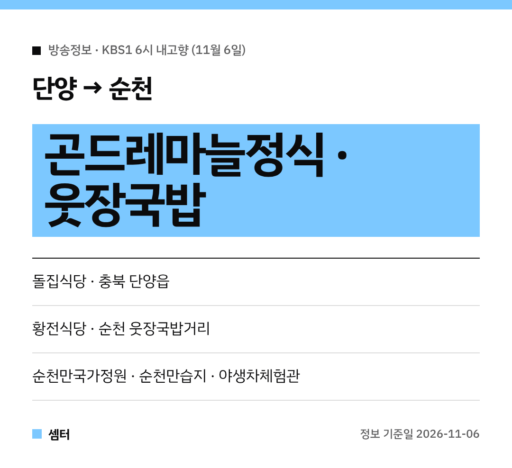

마늘 하면 단양, 국밥 하면 순천 웃장이죠~
11월 6일 KBS1 '6시 내고향'에 두 곳이 다 나왔어요 🍚

## 단양 돌집식당 곤드레마늘정식
충북 단양읍의 **돌집식당**이에요.
대표 메뉴는 **곤드레마늘정식(흑마늘정식)**이랍니다.

단양 특산물 마늘이 곤드레랑 한 상에 올라오는 메뉴예요!
정식은 인원 조건이 있을 수 있으니 전화로 먼저 물어보세요.

[📍 네이버 지도에서 돌집식당 보기](https://map.naver.com/p/search/%EB%8B%A8%EC%96%91%20%EB%8F%8C%EC%A7%91%EC%8B%9D%EB%8B%B9)

## 순천 웃장국밥 황전식당
순천 편에서는 **웃장국밥거리**의 국밥집이 나왔어요.
가게 이름은 **황전식당**이에요.

장터 국밥 한 그릇이면 쌀쌀한 날 몸이 사르르 녹죠 😊

[📍 네이버 지도에서 황전식당 보기](https://map.naver.com/p/search/%EC%88%9C%EC%B2%9C%20%ED%99%A9%EC%A0%84%EC%8B%9D%EB%8B%B9)

## 순천 여행 코스
순천만국가정원, 순천만습지, 순천전통야생차체험관도 함께 소개됐어요.
갈대 보고, 차 한 잔 하고, 국밥으로 마무리하면 딱 좋은 하루 코스예요~

[📍 네이버 지도에서 순천만국가정원 보기](https://map.naver.com/p/search/%EC%88%9C%EC%B2%9C%EB%A7%8C%EA%B5%AD%EA%B0%80%EC%A0%95%EC%9B%90)
[📍 네이버 지도에서 순천전통야생차체험관 보기](https://map.naver.com/p/search/%EC%88%9C%EC%B2%9C%EC%A0%84%ED%86%B5%EC%95%BC%EC%83%9D%EC%B0%A8%EC%B2%B4%ED%97%98%EA%B4%80)

다들 맛있는 거 많이 드시구! 오늘도 좋은 하루 보내세요~ㅎㅎ
