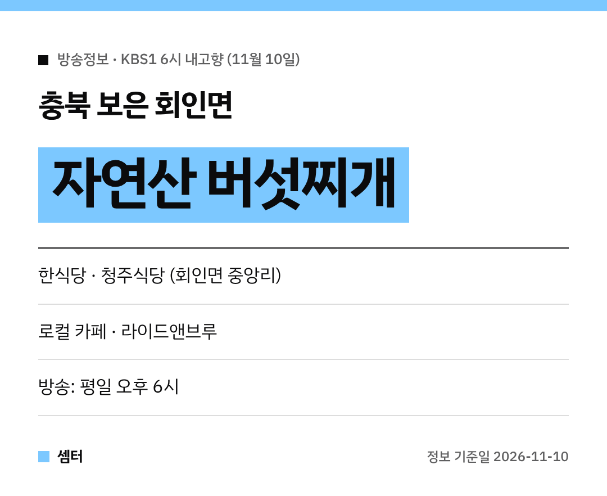

가을 산 버섯 향 가득한 찌개 한 그릇, 생각만 해도 군침 돌죠~
11월 10일 '6시 내고향'은 **충북 보은 회인면**으로 갔어요! 🍄

## 청주식당: 자연산 버섯찌개
회인면 **중앙리**에 있는 한식당 **청주식당**이에요.
지역 주민들이 많이 찾는 숨은 맛집이래요.

대표 메뉴는 **자연산 버섯찌개**예요.
여러 버섯이 어우러져서 향도 식감도 제각각이래요.

닭볶음탕, 토끼탕, 동태찌개, 백숙도 있어서 여럿이 가도 좋아요!
이름은 청주식당이지만 **보은**에 있으니 지도 찾을 때 헷갈리지 마세요 😉

[📍 네이버 지도에서 청주식당 보기](https://map.naver.com/p/search/%EB%B3%B4%EC%9D%80%20%ED%9A%8C%EC%9D%B8%EB%A9%B4%20%EC%B2%AD%EC%A3%BC%EC%8B%9D%EB%8B%B9)

## 로컬 카페: 라이드앤브루
같은 회인면의 카페 **라이드앤브루**도 나왔어요.
식사하고 커피 한잔하기 딱 좋은 코스예요.

[📍 네이버 지도에서 라이드앤브루 보기](https://map.naver.com/p/search/%EB%B3%B4%EC%9D%80%20%EB%9D%BC%EC%9D%B4%EB%93%9C%EC%95%A4%EB%B8%8C%EB%A3%A8)

## 가기 전에
시골 식당이라 영업시간이 일정하지 않을 수 있어요.
출발 전에 지도에서 꼭 확인하고 가세요~

다들 맛있는 가을 여행 하시구! 오늘도 좋은 하루 보내세요~ㅎㅎ
