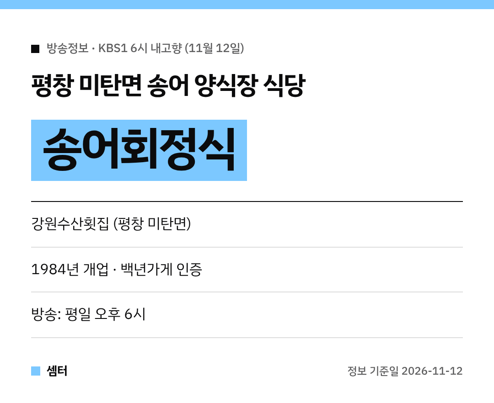

평창 하면 역시 송어죠~
11월 12일 '6시 내고향'에 **송어 양식장에서 바로 운영하는 식당**이 나왔어요! 🐟

## 평창 미탄면 강원수산횟집
강원 평창 미탄면에 있는 **강원수산횟집**이에요.
송어 양식장과 식당을 함께 운영하는 곳이래요.

**1984년**에 문을 열어 40년 넘게 이어 오고 있어요.
중소벤처기업부 **백년가게** 인증도 받았대요.

## 어떤 메뉴가 있어요?
- **송어회**, **송어회정식**
- 송어튀김, 메밀전병
- 어린이돈까스

샘물로 키운 송어를 직접 쓴대요.
함께 나오는 재료도 주변 농가에서 산 국내산 위주래요 😋

## 위치
강원 평창군 미탄면 송어길 30-4예요.

[📍 네이버 지도에서 강원수산횟집 보기](https://map.naver.com/p/search/%ED%8F%89%EC%B0%BD%20%EA%B0%95%EC%9B%90%EC%88%98%EC%82%B0%ED%9A%9F%EC%A7%91)

## 가기 전에
산골 식당이라 쉬는 날이 있을 수 있어요.
출발 전에 지도에서 영업일을 꼭 확인하세요~

다들 맛있는 송어 드시구! 오늘도 좋은 하루 보내세요~ㅎㅎ
