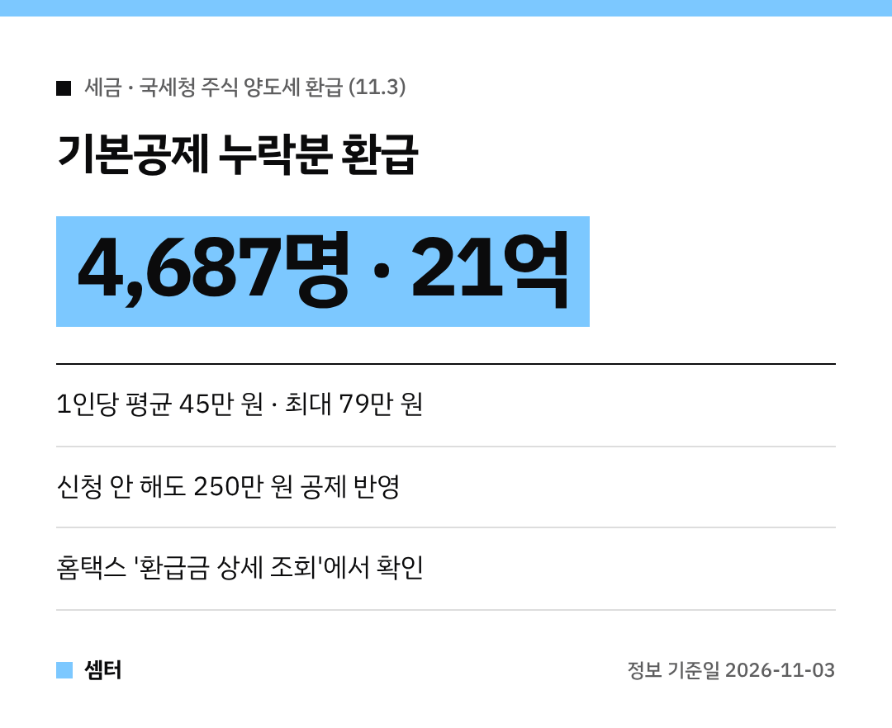

해외주식 하시는 분들, 양도세 신고할 때 기본공제 넣으셨나요~?
빠뜨린 분들께 국세청이 **알아서 세금을 돌려줬대요** 😊

## 무슨 일이에요?
국세청이 **2021~2025년 귀속** 주식 양도소득세 신고를 살펴봤어요.
신고서에 기본공제를 빼먹고 세금을 더 낸 **4,687명**에게 **21억 원**을 11월 3일 환급했대요.

1인당 평균 45만 원꼴이고, 가장 많이 받은 분은 **79만 원**이에요.

## 신청 안 했는데 왜 받아요?
양도소득에는 **기본공제 250만 원**이 붙는데, 이걸 모르거나 실수로 빠뜨린 경우가 많았대요.
그래서 따로 신청하지 않아도 국세청이 누락분을 반영해서 돌려준 거예요 👍

주식 양도세는 국내주식은 반기별 예정신고, 해외주식은 확정신고로 나뉘어 있어서 헷갈리기 쉬운 편이죠.

## 나도 받았는지 확인하는 법
1. 홈택스(또는 손택스) 접속
2. **'환급금 상세 조회'** 메뉴로 들어가기
3. 이미 받은 환급금과 아직 못 받은 환급금이 같이 보여요

국세환급금통지서는 모바일이나 우편으로도 와요.

## 계좌를 등록 안 했다면
국세청에 환급계좌가 있으면 그 계좌로 바로 들어와요.
없다면 '환급금 상세 조회'에서 **'지급신청'**을 누르고 본인 명의 계좌를 입력하면 돼요.

혹시 환급을 핑계로 계좌 비밀번호를 묻는 연락이 오면 절대 알려 주지 마세요!

다들 놓친 돈 꼭 찾으시구! 오늘도 좋은 하루 보내세요~ㅎㅎ
