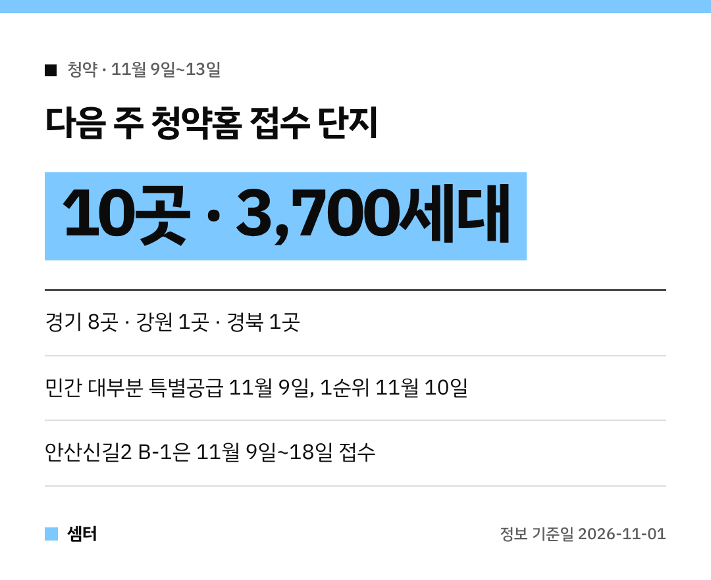
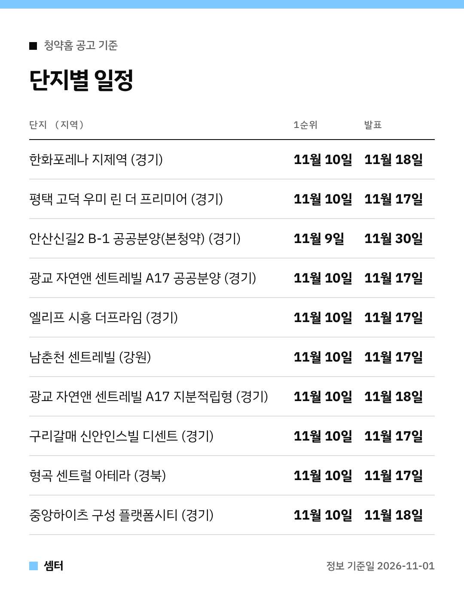

다음 주(11월 9일~13일) 청약홈 접수 단지를 미리 정리해 봤어요~
모두 **10곳**, 합치면 **3,700세대**예요! 😊

날짜는 전부 청약홈 공고에 적힌 일정을 그대로 옮겼어요.
해당지역·기타지역 접수일이 다를 수 있으니, 신청 전에 공고문을 한 번 더 확인해 주세요!

## 단지별 접수일·당첨자 발표일

| 단지 (지역) | 특별공급 | 1순위 | 2순위 | 당첨자 발표 | 공급 |
|---|---|---|---|---|---|
| 한화포레나 지제역 (경기) | 11월 9일 | 11월 10일 | 11월 11일 | 11월 18일 | 1098세대 |
| 평택 고덕 우미 린 더 프리미어 (경기) | 11월 9일 | 11월 10일 | 11월 11일 | 11월 17일 | 623세대 |
| 안산신길2지구 B-1블록 공공분양주택(본청약) (경기) | - | 11월 9일 | 11월 18일 | 11월 30일 | 387세대 |
| 광교 자연앤 센트레빌(A17BL) 공공분양주택 (경기) | 11월 9일 | 11월 10일 | 11월 11일 | 11월 17일 | 360세대 |
| 엘리프 시흥 더프라임 (경기) | 11월 9일 | 11월 10일 | 11월 11일 | 11월 17일 | 304세대 |
| 남춘천 센트레빌 (강원) | 11월 9일 | 11월 10일 | 11월 11일 | 11월 17일 | 264세대 |
| 광교 자연앤 센트레빌(A17BL) 지분적립형 분양주택 (경기) | 11월 9일 | 11월 10일 | 11월 11일 | 11월 18일 | 240세대 |
| 구리갈매역세권 B-1블록 신안인스빌 디센트 (경기) | 11월 9일 | 11월 10일 | 11월 11일 | 11월 17일 | 213세대 |
| 형곡 센트럴 아테라 (경북) | 11월 9일 | 11월 10일 | 11월 11일 | 11월 17일 | 135세대 |
| 중앙하이츠 구성 플랫폼시티 (경기) | 11월 9일 | 11월 10일 | 11월 12일 | 11월 18일 | 76세대 |

## 평택 2곳: 한화포레나 지제역 · 고덕 우미 린
**한화포레나 지제역**이 **1098세대**로 이번 주 가장 커요.
특별공급 11월 9일 · 1순위 11월 10일 · 발표 11월 18일이에요.

**평택 고덕 우미 린 더 프리미어**는 **623세대**, 발표는 하루 빠른 11월 17일이에요.

## 광교 자연앤 센트레빌 A17 (공공분양 · 지분적립형)
같은 A17블록인데 공고가 두 개예요.
공공분양 **360세대**는 11월 17일, 지분적립형 **240세대**는 11월 18일 발표예요 📝

## 구리·시흥·용인 민간 3곳
- 구리갈매역세권 신안인스빌 디센트 **213세대** · 발표 11월 17일
- 엘리프 시흥 더프라임 **304세대** · 발표 11월 17일
- 중앙하이츠 구성 플랫폼시티 **76세대** · 2순위 11월 12일, 발표 11월 18일

## 안산신길2지구 B-1 공공분양(본청약)
**387세대**이고, 접수 기간이 **11월 9일~18일**로 길어요.
발표는 **11월 30일**이에요.

## 지방 2곳
- 남춘천 센트레빌(강원) **264세대** · 발표 11월 17일
- 형곡 센트럴 아테라(경북 구미) **135세대** · 발표 11월 17일

## 신청 전에 챙길 것
신청은 청약홈(applyhome.co.kr)에서 해요.
인증서 로그인이 필요하니 미리 한 번 들어가 보시면 당일에 덜 급해요~

분양가와 자격 조건은 단지마다 달라서 이 글에선 다루지 않았어요.
공고문에서 꼭 확인해 주세요 🙏

다들 청약 꼭 당첨 되시구! 오늘도 좋은 하루 보내세요~ㅎㅎ
