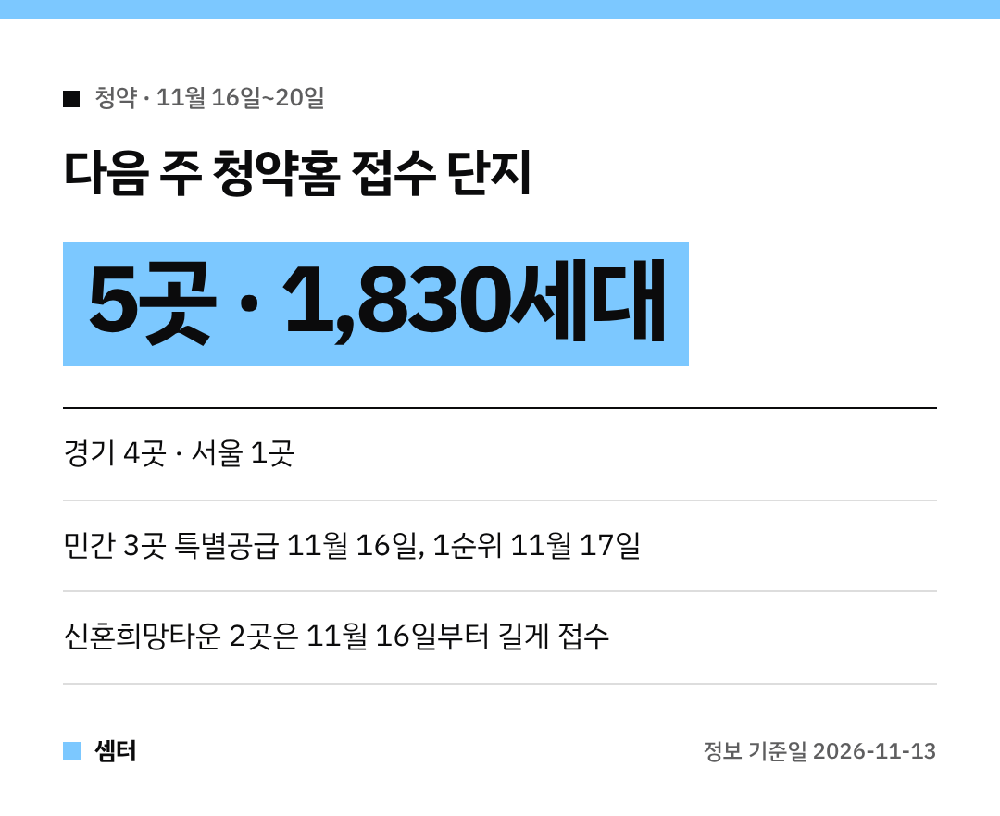
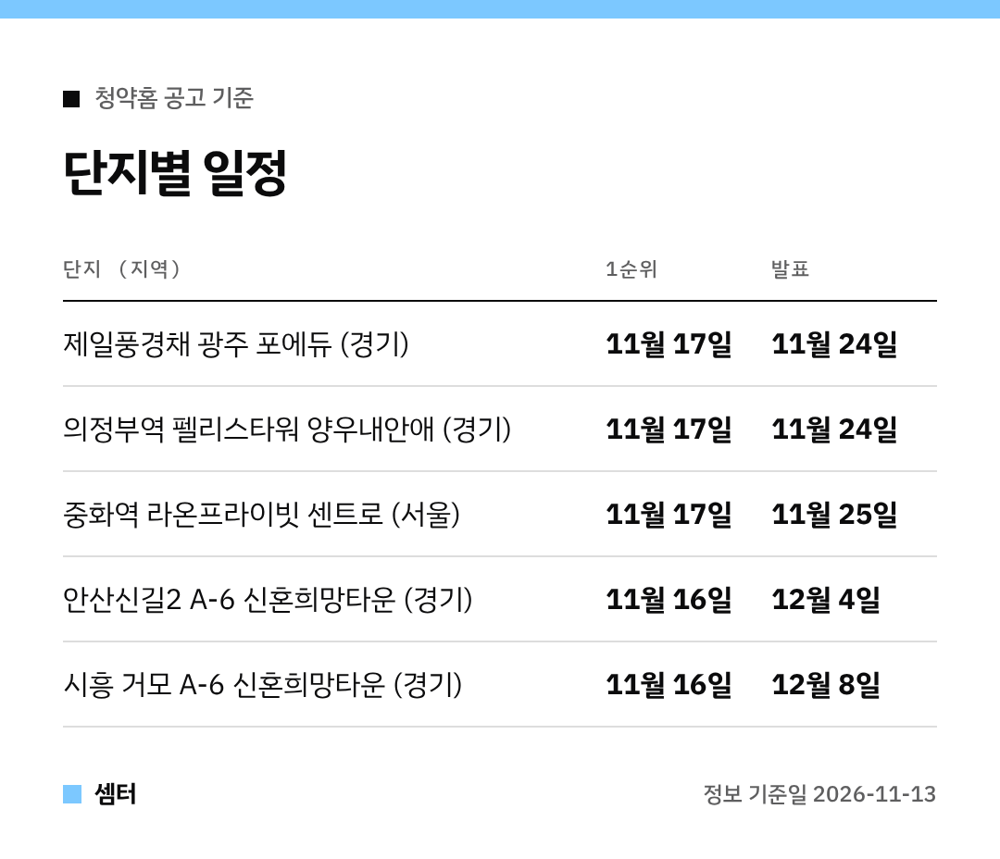

다음 주(11월 16일~20일) 청약홈 접수 단지를 미리 정리해 봤어요~
모두 **5곳**, 합치면 **1,830세대**예요! 😊

날짜는 전부 청약홈 공고에 적힌 일정을 그대로 옮겼어요.
해당지역·기타지역 접수일이 다를 수 있으니, 신청 전에 공고문을 한 번 더 확인해 주세요!

## 단지별 접수일·당첨자 발표일

| 단지 (지역) | 특별공급 | 1순위 | 2순위 | 당첨자 발표 | 공급 |
|---|---|---|---|---|---|
| 제일풍경채 광주 포에듀 (경기) | 11월 16일 | 11월 17일 | 11월 18일 | 11월 24일 | 572세대 |
| 의정부역 펠리스타워 양우내안애 (경기) | 11월 16일 | 11월 17일 | 11월 18일 | 11월 24일 | 414세대 |
| 중화역 라온프라이빗 센트로 (서울) | 11월 16일 | 11월 17일 | 11월 19일 | 11월 25일 | 113세대 |
| 안산신길2 A-6블록 신혼희망타운(공공분양)(본청약) (경기) | - | 11월 16일 | 11월 24일 | 12월 4일 | 251세대 |
| 시흥 거모 아테라(시흥거모 A-6BL) 신혼희망타운(공공분양)(본청약) (경기) | - | 11월 16일 | 11월 27일 | 12월 8일 | 480세대 |

## 제일풍경채 광주 포에듀 (경기 광주 탄벌)
**572세대**로 이번 주 가장 커요.
특별공급 11월 16일 · 1순위 11월 17일 · 발표 11월 24일이에요.

## 의정부역 펠리스타워 양우내안애
**414세대**이고, 일정은 광주 포에듀와 똑같아요.
특별공급 11월 16일 · 1순위 11월 17일 · 발표 11월 24일이에요 📝

## 중화역 라온프라이빗 센트로 (서울 중랑)
이번 주 유일한 서울 단지예요.
**113세대**이고, 2순위가 **11월 19일**이라 발표도 하루 늦은 **11월 25일**이에요.

## 신혼희망타운 2곳 (공공분양 본청약)
- 안산신길2 A-6블록 **251세대** · 접수 **11월 16일~24일** · 발표 **12월 4일**
- 시흥 거모 아테라 A-6블록 **480세대** · 접수 **11월 16일~27일** · 발표 **12월 8일**

두 곳 다 접수 기간이 길고, 발표는 12월이에요.

## 신청 전에 챙길 것
신청은 청약홈(applyhome.co.kr)에서 해요.
인증서 로그인이 필요하니 미리 한 번 들어가 보시면 당일에 덜 급해요~

분양가와 자격 조건은 단지마다 달라서 이 글에선 다루지 않았어요.
공고문에서 꼭 확인해 주세요 🙏

다들 청약 꼭 당첨 되시구! 오늘도 좋은 하루 보내세요~ㅎㅎ
