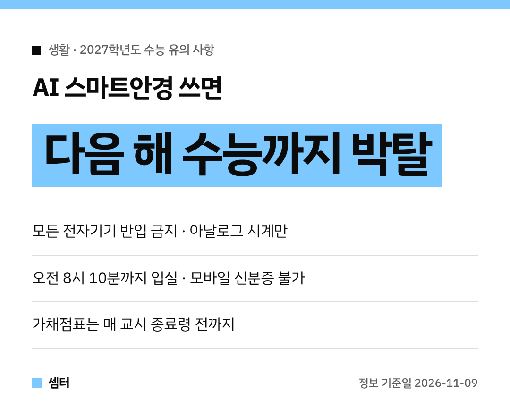

수능이 정말 코앞으로 다가왔네요~
교육부가 **수험생 유의 사항**을 발표했는데, 올해는 꼭 알아야 할 새 내용이 있어요!

바로 **AI 스마트안경**이에요.
시험 중에 쓰면 **다음 해 수능 응시 자격까지** 박탈된대요 😮

## 반입 금지 물품
AI 스마트안경, 휴대전화, 스마트워치, 전자담배, 블루투스 이어폰 등 **모든 전자기기**는 시험장에 가져가면 안 돼요.

혹시 가져갔다면 1교시 시작 전 수거 시간에 감독관에게 내면 돼요.
시험이 끝나면 돌려받아요.

내지 않고 갖고 있다가 걸리면 **부정행위**로 처리되고, 그 시험은 무효가 돼요.

## 시계는 아날로그만
결제·통신 기능도 없고, LCD·LED 같은 전자식 화면도 없는 **아날로그 시계**만 찰 수 있어요.

보청기, 돋보기, 연속혈당측정기처럼 몸 상태 때문에 꼭 필요한 물건은 괜찮아요.
매 교시 감독관이 미리 점검한 뒤 쓸 수 있어요.

## 입실과 신분증
**오전 8시 10분까지** 시험실에 들어가야 해요.
수험표와 사진이 붙은 유효기간 안의 신분증을 챙기세요.

**모바일 신분증은 안 돼요!**
꼭 실물 신분증을 가져가세요.

## 수험표를 잃어버렸다면
응시원서와 같은 사진 1장, 신분증을 들고 당일 **오전 8시까지** 시험장 안 시험 관리본부로 가면 다시 받을 수 있어요.
사진이 없어도 신고하면 임시 수험표를 받을 수 있답니다.

## 4교시 꼭 챙길 것
- **한국사는 필수**예요. 안 보면 시험 전체가 무효가 되고 성적표도 안 나와요
- 탐구는 내가 고른 과목 순서대로, 그 과목 문제지만 책상 위에 올려요
- 제2선택 시간에 끝난 제1선택 답을 고치면 부정행위예요

## 답안지와 가채점표
답안지는 **검은색 컴퓨터용 사인펜**이 원칙이에요.
필적확인문구도 같은 펜으로 써야 해요.

올해부터 수험표 뒤에 가채점표가 있어요.
**매 교시 종료령 전까지** 적어야 하고, 종료령 뒤에 쓰면 부정행위예요!

## 더 자세히 보려면
유의 사항 자료집과 영상은 대학수학능력시험 누리집(suneung.re.kr)에 있어요.

수험생 여러분 모두 실력 다 발휘하시구! 오늘도 좋은 하루 보내세요~ㅎㅎ
