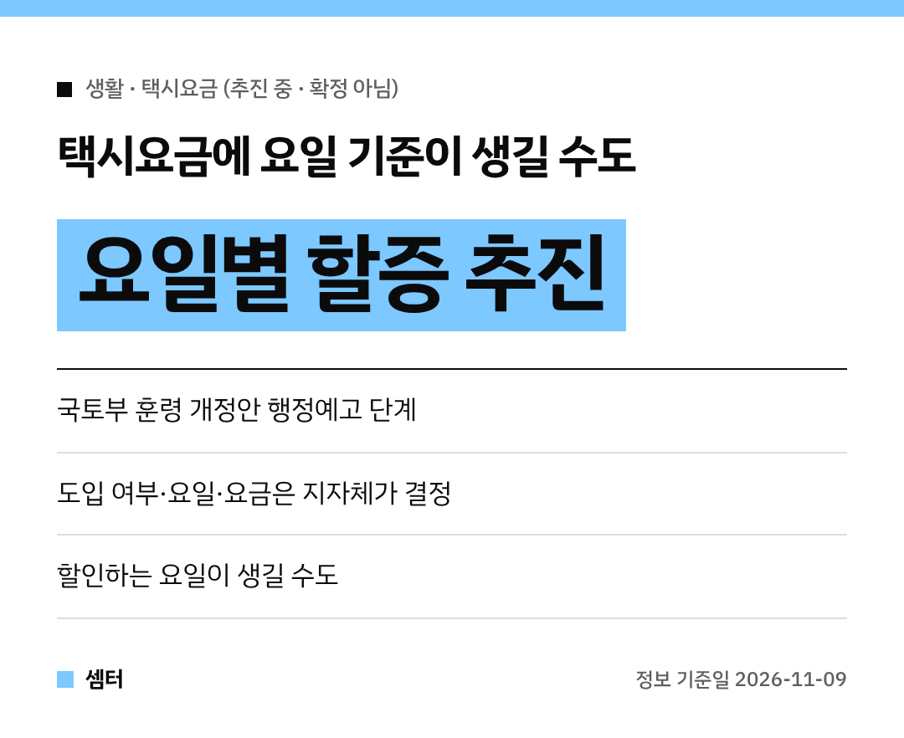

불금에 택시 잡기 힘드셨던 분들 많으시죠~
그런데 앞으로는 **요일에 따라 택시요금이 달라질 수도** 있대요!

다만 아직 **확정은 아니에요**.
정부가 규정을 고치려고 미리 알리는 행정예고 단계랍니다 😊

## 바뀌는 훈령 내용
국토교통부가 택시요금 규정을 손보는 훈령 개정안을 행정예고했어요.
훈령 이름은 '여객자동차 운송사업 운임·요율 등 조정요령'이에요.

핵심은 지자체가 정할 수 있는 택시요금 항목에 **'요일별 할인·할증'**을 넣는 거예요.
지금까지 할증은 주로 밤 시간대처럼 시간 기준이었거든요.

## 금요일 밤에 더 비싸지는 거예요?
그렇게 될 수도 있어요.
금요일이나 주말처럼 택시가 부족한 날 요금을 올려서, 택시가 더 많이 다니게 하려는 거예요.

반대로 특정 요일엔 **할인**하는 방식도 가능해요.
꼭 오르기만 하는 건 아니라는 점, 알아 두시면 좋아요~ 😉

## 우리 동네도 바로 바뀌나요?
아니에요!
전국에 한꺼번에 적용되는 게 아니에요.

도입할지 말지, 어떤 요일에 얼마나 붙일지는 **각 지자체**가 정해요.
지역마다 택시 사정이 다르니까 그걸 보고 고르게 한 거예요.

## 지금 달라지는 게 있나요?
지금 당장 바뀌는 건 없어요.
행정예고 단계라 실제로 시행할지, 어떤 요일에 얼마로 할지는 아직 정해지지 않았어요.

훈령이 바뀌어도 우리 지역에서 쓰려면 지자체가 따로 요금을 정해야 해요.
사는 지역 시·도 소식을 가끔 확인해 보시면 좋겠어요!

## 전문가 시각
전문가들은 택시 공급과 서비스가 나아질 수 있다고 봤어요.
그래도 밤 할증에 요일 할증까지 겹치면 요금 부담이 커질 수 있다는 걱정도 함께 나왔답니다.

다들 안전하게 귀가하시구! 오늘도 좋은 하루 보내세요~ㅎㅎ
