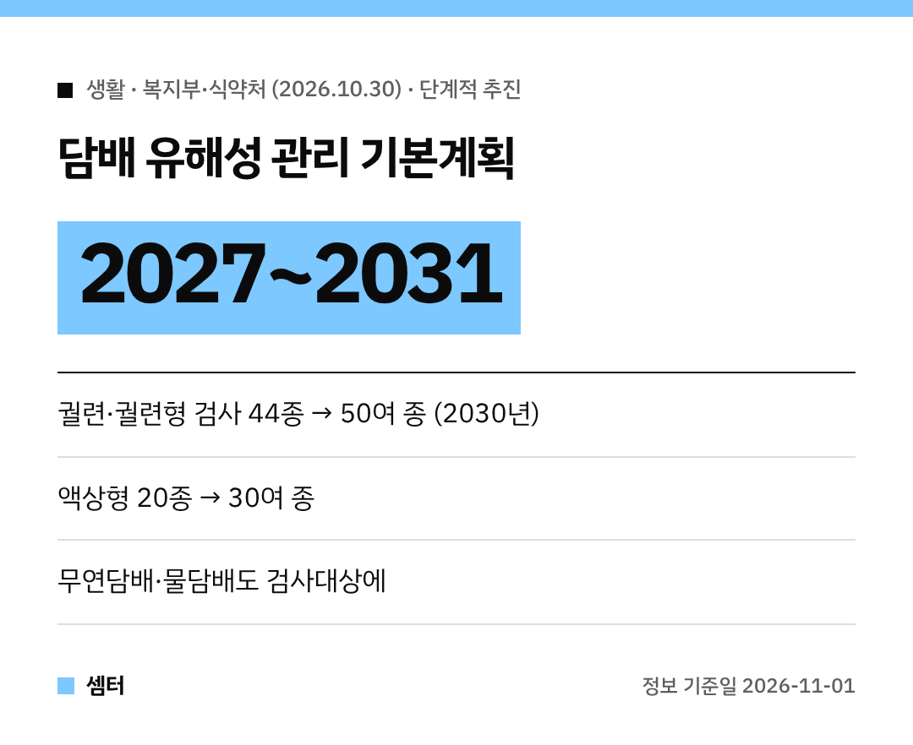

담배 피우시는 분들, 또는 가족 중에 흡연자가 있는 분들 주목해 주세요~!
정부가 담배 속 유해성분을 훨씬 꼼꼼하게 들여다보는 **5년 계획**을 내놨어요 😊

이름은 **'제1차 담배 유해성 관리 기본계획(2027~2031)'**이에요.
지난 **29일** 위원회 심의를 거쳐 확정됐답니다.

## 왜 나온 계획이에요?
담배 연기에는 **70종 이상의 발암물질**과 **7000종 이상의 화학물질**이 들어 있대요.
2023년 기준 직접 흡연으로 인한 사망자는 **6만 8536명**이었고요.

궐련 흡연율은 2019년 20.3%에서 2025년 17.9%로 줄었지만, 전자담배까지 합친 **전체 담배제품 사용률은 21.6% → 22.1%**로 큰 변화가 없었어요.

## 검사 항목이 늘어나요
| 구분 | 지금(2025년) | 2030년 목표 |
|---|---|---|
| 궐련·궐련형 전자담배 | 44종 | 50여 종 |
| 액상형 전자담배 | 20종 | 30여 종 |

지금은 검사하지 않는 **무연담배, 엽궐련, 물담배**도 새로 검사대상에 들어가요 🙂

## 제조·수입업자 자료도 더 꼼꼼히
- 성분과 첨가물 **이름뿐 아니라 사용 용도**까지 내야 해요.
- 제출 자료는 **무작위 불시 현장점검**으로 확인해요.
- 맛·향을 높이는 첨가물은 정보를 모아 분석하고, 특정 성분을 **단계적으로 금지하는 방안을 검토**한대요.

## 새 담배 제품은 더 빨리 검사
지금은 판매 다음 해가 시작된 뒤 6개월 안에 검사를 맡기면 되는데요.
앞으로는 **판매 시작 후 1개월 안**으로 바꿀 계획이에요. 최대 **17개월**이 앞당겨지는 셈이에요.

## 정보 공개도 넓혀요
담배 유해성분 **정보공개 방안**을 마련하고, 모은 자료는 흡연예방교육과 금연 홍보에 쓸 계획이에요.

정부 목표는 2030년까지 성인 담배제품 사용률을 **남성 29.0%, 여성 6.0%**로 낮추는 거래요.

금연을 고민 중이라면 이번 기회에 한번 마음먹어 보셔도 좋겠어요~
다들 건강 챙기시구! 오늘도 좋은 하루 보내세요~ㅎㅎ
