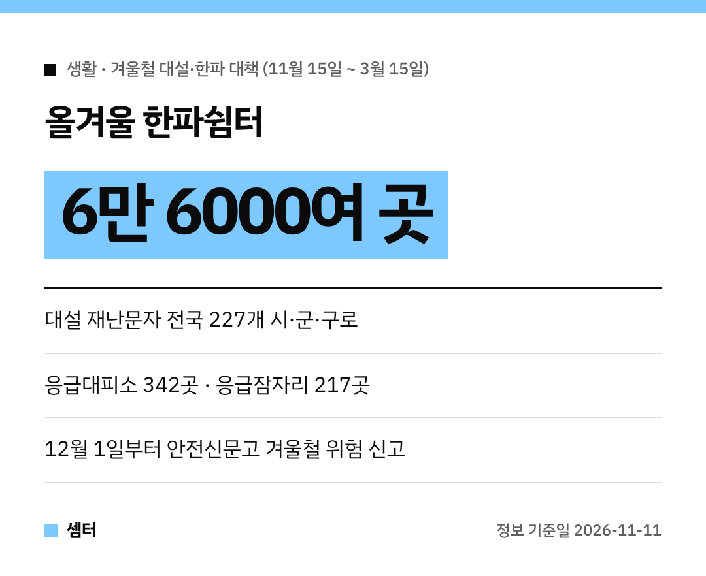

벌써 아침저녁으로 손이 꽁꽁 어는 계절이 왔네요~
정부가 **올겨울 대설·한파 대책**을 내놨는데, 우리 생활에 바로 쓸 정보만 골라 봤어요! ❄️

## 언제부터예요?
**11월 15일부터 내년 3월 15일까지** '겨울철 자연재난 대책기간'이에요.
대설·한파 위기경보 '관심' 단계도 발령해서 정부가 함께 대응한대요.

기상청은 올겨울 기온이 평년과 비슷하거나 높고, 눈비는 평년과 비슷하거나 많을 걸로 봤어요.
기온 변동이 크고 지역에 따라 **눈이 많이 올 수 있다**고 하니 대비는 필수예요.

## 재난문자가 전국으로
눈 때문에 생기는 교통사고·시설물 붕괴 위험을 알려주는 대설 재난문자가 있어요.
시범 지역 101곳에서 **전국 227개 시·군·구**로 늘어나요.

## 추울 땐 한파쉼터로
한파쉼터가 작년 5만 3천여 곳에서 올해 **6만 6천여 곳**으로 늘어나요.
은행이나 우체국 같은 곳과도 협약했대요.

- **24시간 응급대피소 342곳**
- 쪽방주민·노숙인 **응급잠자리 217곳**
- 버스정류장 온열의자·방풍시설 등 **4만 6천여 곳**

## 운전하신다면
눈 예보가 있으면 1~2시간 전에 제설제를 미리 뿌린대요.
**밤 11시부터 아침 8시까지** 도로 살얼음 순찰도 강화하고요.

도로 살얼음 위험 정보는 **내비게이션 앱과 도로전광표지판**으로 실시간 알려준대요.

## 우리 동네 위험은 직접 신고!
**12월 1일부터 2027년 3월 15일까지** 안전신문고에서 '겨울철 위험요소 집중신고 기간'을 운영해요.
제설이 안 된 곳, 제설함 관리가 엉망인 곳을 신고하면 고쳐 준대요.

## 집에서 챙길 것
- 수도·계량기 보온하기 (동파 대비)
- 눈 오면 대중교통 이용하기
- 내 집·가게 앞 눈 치우기

어르신들은 생활지원사 3만 7천여 명이 전화나 방문으로 안부를 확인하고 담요·양말 같은 방한용품도 챙겨 준대요.

다들 따뜻하고 안전한 겨울 보내시구! 오늘도 좋은 하루 보내세요~ㅎㅎ
