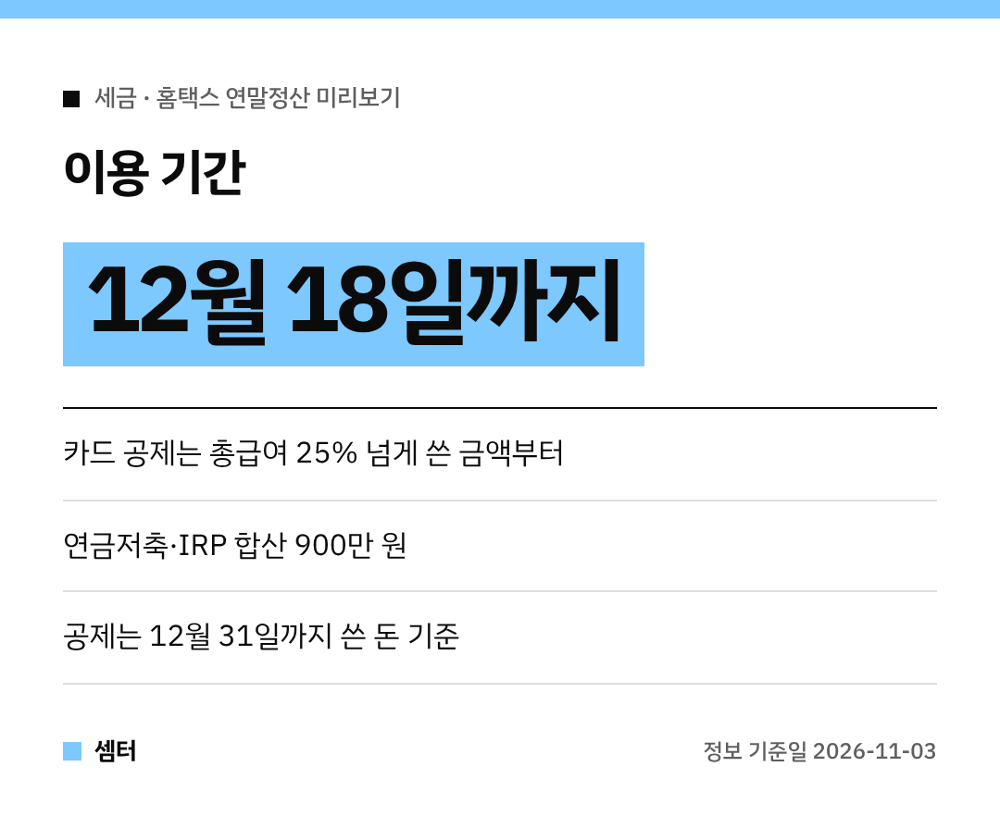

13월의 월급, 올해는 얼마나 될까 궁금하시죠~?
홈택스 **연말정산 미리보기**로 지금 바로 예상해 볼 수 있어요 😊

## 미리보기, 언제까지 돼요?
올해 예상 소득과 지출을 바탕으로 **내년 1월 연말정산 예상 세액**을 계산해 줘요.
이용 기간은 **12월 18일까지**예요.

홈택스에서 '연말정산 미리보기'로 들어가면 돼요.
나오는 환급액은 어디까지나 예상이라, 실제 소득·지출에 따라 달라질 수 있어요.

## 올해 달라진 공제
작년이랑 똑같이 생각하면 놓치는 게 있어요.

- 교육비: 직계비속 **소득요건이 없어져서** 공제 대상이 넓어졌어요
- 고향사랑기부: 10만 원 초과~20만 원 이하 구간에 **40%** 세액공제

## 연말까지 챙길 것 ① 카드는 25% 문턱부터
카드 소득공제는 총급여의 **25%를 넘게 쓴 금액**부터 적용돼요.
신용카드는 15%, 체크카드·현금영수증은 30%예요.

미리보기로 25%를 넘었는지 먼저 보고, 넘었다면 남은 기간엔 체크카드 쪽이 유리해요!
공제율이 두 배 차이라 같은 돈을 써도 결과가 달라져요 👍

## ② 연금저축·IRP 한도 확인
연금저축은 연 600만 원, IRP까지 합치면 **900만 원**까지 세액공제 대상이에요.
다만 중간에 해지하면 세금 부담이 생기니, 노후 자금 범위에서만 넣으세요.

## ③ 의료비는 3% 넘은 금액부터
의료비는 총급여의 **3%를 넘게 쓴 금액**부터 공제돼요.
실손보험으로 돌려받은 금액은 빼야 해요.

## ④ 월세 사는 무주택자라면
요건을 채우면 연 **1000만 원** 한도에서 **15% 또는 17%** 세액공제를 받아요.
임대차계약서와 월세 낸 증빙은 미리 모아 두세요.

## ⑤ 주택청약·고향사랑기부도 점검
주택청약종합저축 소득공제와 고향사랑기부금도 연말 절세에 도움이 돼요.
대부분 공제는 **12월 31일까지** 쓰고 넣은 돈만 올해 몫이라, 연말 전에 챙겨야 해요.

다들 13월의 월급 두둑하게 받으시구! 오늘도 좋은 하루 보내세요~ㅎㅎ
