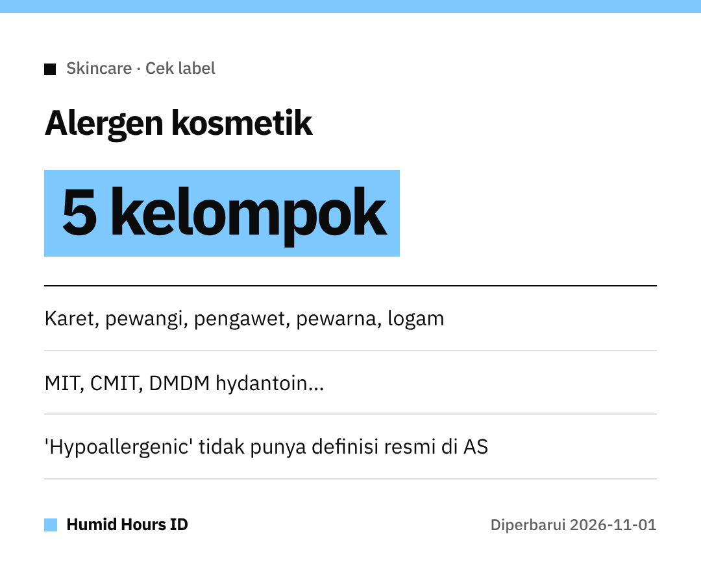

Halo semuanya!
Ganti losion baru, eh kulit malah gatal dan merah?
FDA AS punya daftar yang bisa bantu kita baca label sebelum beli.

## 5 kelompok yang sering jadi pemicu
Menurut FDA AS, kebanyakan reaksi alergi dari kosmetik berasal dari 5 kelompok:
**karet alami, pewangi, pengawet, pewarna, dan logam**.

Reaksi paling sering berupa **ruam merah yang gatal** (dermatitis kontak alergi).

## Nama pengawet yang perlu dicek
- Methylisothiazolinone (**MIT**)
- Methylchloroisothiazolinone (**CMIT**)
- Bahan pelepas formaldehida seperti **DMDM hydantoin**, **diazolidinyl urea**, **imidazolidinyl urea**, **quaternium-15**, **bronopol**

## Label tidak bisa menjamin semuanya
Istilah **"hypoallergenic", "fragrance-free", "untuk kulit sensitif"** **tidak punya standar atau definisi federal** di AS.
Beberapa bahan juga bisa ditulis umum saja sebagai **"fragrance"** atau **"perfume"**.

## Yang bisa dilakukan
- Baca **daftar bahan**, hindari yang kamu tahu bikin alergi.
- Masih ragu? **Hubungi produsen** yang tertera di label.
- Kalau curiga alergi, temui **tenaga kesehatan**.

Sehat selalu kulitnya!
