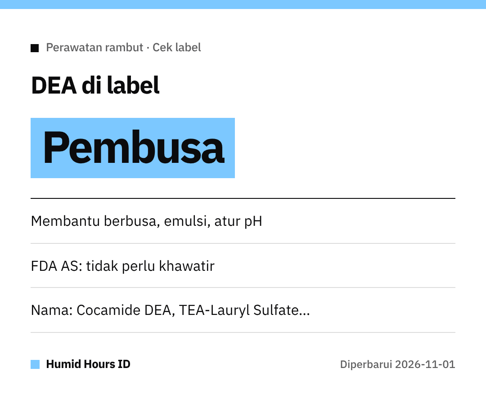

Halo semuanya!
Suka sampo yang busanya melimpah?
Busa itu bisa berasal dari bahan **DEA**. Ini kata FDA AS.

## Fungsi DEA
Diethanolamine (DEA) dan bahan terkait berfungsi sebagai **pengemulsi, pembusa**, atau **pengatur pH**.

## Kenapa sempat dipertanyakan?
Studi NTP tahun **1998** pada **hewan laboratorium** sempat memunculkan pertanyaan.
Studi itu **tidak membuktikan kaitan** DEA dengan risiko kanker pada manusia.

## Kata FDA AS
FDA menyatakan saat ini **tidak ada alasan bagi konsumen untuk khawatir**.
Bahan ini juga tampaknya **jauh lebih jarang** dipakai dibanding dulu.

## Mau menghindari? Cek nama ini
- Cocamide DEA / Cocamide MEA
- Lauramide DEA
- Myristamide DEA
- Oleamide DEA
- Linoleamide MEA / Stearamide MEA
- DEA-Cetyl Phosphate / DEA Oleth-3 Phosphate
- TEA-Lauryl Sulfate / Triethanolamine

Selamat belanja!
