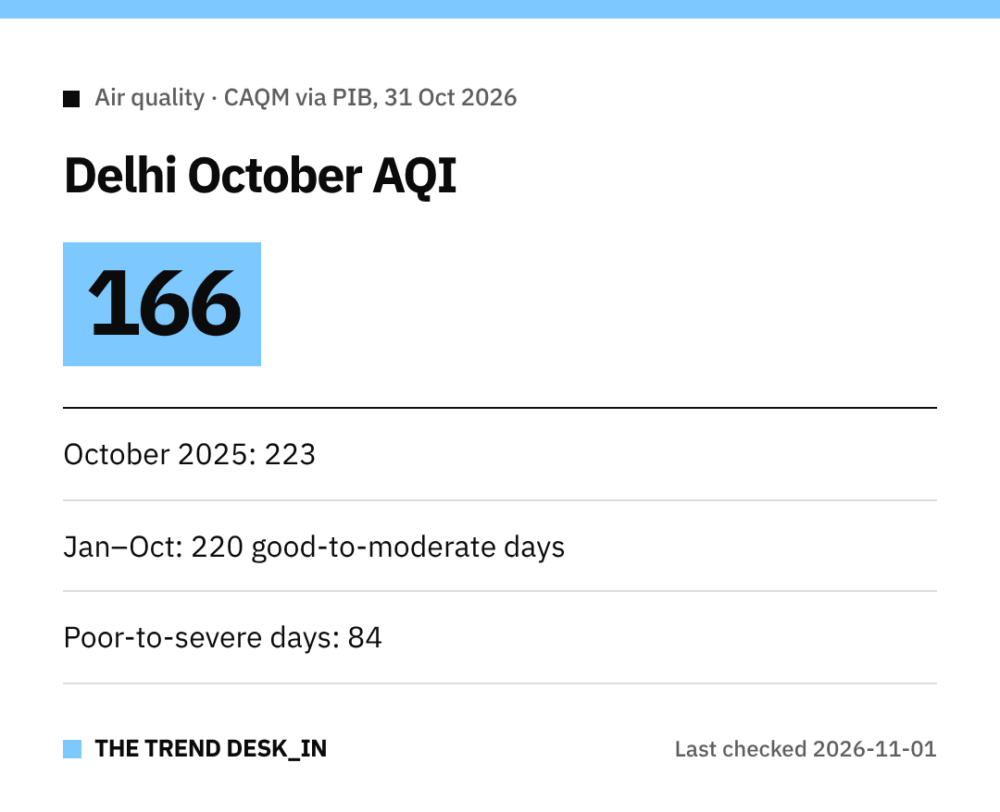

Some rare good news for Delhi's air.
The city's **average AQI for October 2026 was 166**, the lowest October figure in the last eight years.

For comparison, October 2025 averaged **223**.

## October AQI, year by year

| Year | October average AQI |
|---|---|
| 2026 | 166 |
| 2025 | 223 |
| 2024 | 234 |
| 2023 | 219 |
| 2022 | 210 |
| 2021 | 173 |
| 2020 | 265 |
| 2019 | 234 |
| 2018 | 269 |

## The bigger picture: January to October
- Average AQI for **1 January to 31 October 2026: 167**, versus **170** in 2025.
- Average **PM2.5** (1 Jan to 29 Oct): **69 µg/m³**, versus **72 µg/m³** in 2025.
- Average **PM10** (same period): **171 µg/m³**, slightly higher than **166 µg/m³** in 2025.

## Good days vs bad days
From January to October 2026, Delhi had:
- **220 'Good to Moderate' days** (daily AQI below 200), up from 200 in 2025
- **84 'Poor to Severe+' days** (daily AQI above 200), down from 104 in 2025

## What happens next
The **Commission for Air Quality Management (CAQM)** says it is working with stakeholders on measures to prevent and control air pollution in Delhi-NCR.
It says these efforts will be **intensified** in the coming days.

It's still worth checking the daily AQI before outdoor plans.

Stay well, Delhi!
