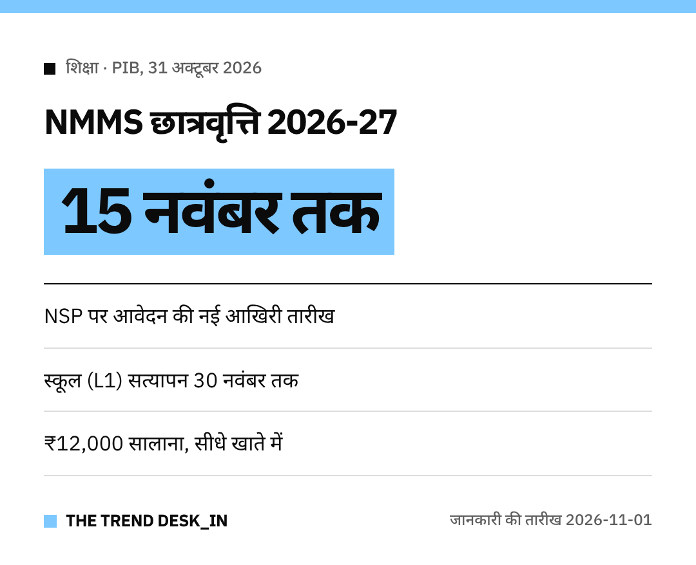

नमस्ते दोस्तों!
आठवीं के बाद पढ़ाई जारी रखने वाले होनहार बच्चों के लिए अच्छी खबर है।

**राष्ट्रीय साधन-सह-योग्यता छात्रवृत्ति (NMMSS)** 2026-27 के लिए आवेदन की आखिरी तारीख अब **15 नवंबर 2026** है।
आवेदन **नेशनल स्कॉलरशिप पोर्टल (NSP)** पर करना है।

## नई तारीखें
- **आवेदन:** 15 नवंबर 2026 तक
- **स्कूल नोडल अधिकारी (L1) सत्यापन:** 30 नवंबर 2026 तक
- **ज़िला नोडल अधिकारी (L2) सत्यापन:** 15 दिसंबर 2026 तक

जिन्होंने पहले ही आवेदन कर दिया है, वे सत्यापन समय पर पूरा करवा लें।

## आवेदन से पहले
पोर्टल पर पहले **वन-टाइम रजिस्ट्रेशन (OTR)** करना ज़रूरी है।

## कितनी राशि मिलती है?
हर साल **₹12,000**, जो **DBT** से सीधे छात्र के बैंक खाते में आते हैं।
हर साल **एक लाख** नई छात्रवृत्तियां कक्षा 9 के उन बच्चों को मिलती हैं जो राज्य की चयन परीक्षा पास करते हैं।
शर्तें पूरी करने पर कक्षा 10 से 12 तक नवीनीकरण होता है।

## कौन आवेदन कर सकता है?
- सरकारी, सरकारी सहायता प्राप्त और स्थानीय निकाय के स्कूलों के छात्र
- चयन परीक्षा के लिए कक्षा 7 में कम से कम **55% अंक** (SC/ST को **5 प्रतिशत अंक** की छूट)
- माता-पिता की सालाना आय **₹3.50 लाख** से ज़्यादा न हो

आखिरी दिन का इंतज़ार मत कीजिए, आज ही आवेदन पूरा करें।
सभी बच्चों को शुभकामनाएं!
