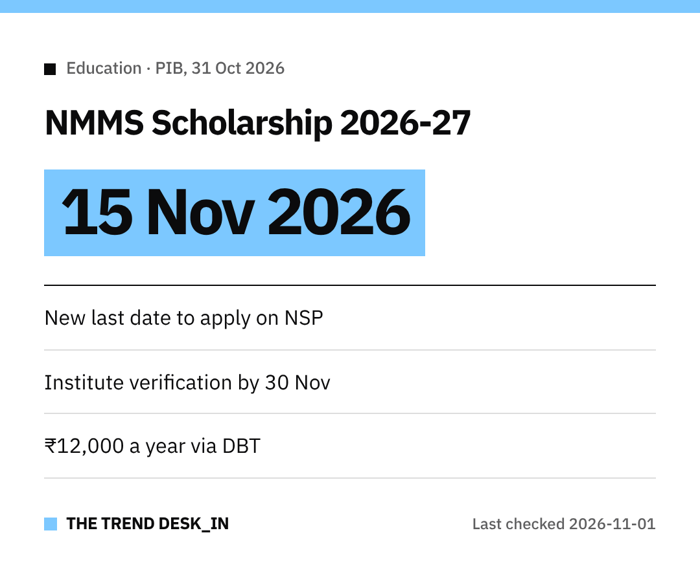

Students and parents, here's some breathing room.
The last date to apply for the **National Means-cum-Merit Scholarship (NMMSS)** for **2026-27** has been extended to **15 November 2026**.

Applications go through the **National Scholarship Portal (NSP)**.

## The revised dates

| Step | Last date |
|---|---|
| Submit application | 15 November 2026 |
| Institute Nodal Officer (L1) verification | 30 November 2026 |
| District Nodal Officer (L2) verification | 15 December 2026 |

Already applied?
Make sure your school's **L1 verification is done by 30 November** and **L2 by 15 December**.

## Before you apply
NSP has been open since **1 June 2026**.
You need to complete **One-Time Registration (OTR)** on the portal first.

As of **30 October 2026**, **90,483 fresh** and **1,99,531 renewal** applications had been submitted.

## How much is the scholarship?
**₹12,000 a year**, paid directly to the student's bank account through **DBT**.

Each year, **one lakh** fresh scholarships go to eligible **Class IX** students who clear the state/UT selection test.
It continues for **Classes X to XII** through renewal, if academic requirements are met.

## Who can apply?
- Students in **state government, government-aided and local body schools**
- At least **55% marks** (or equivalent grade) in **Class VII** to sit the selection test, with **5 percentage points relaxation** for SC/ST students
- Parental income **not above ₹3.50 lakh** a year

## Quick tip
Don't wait for the last day.
Finish OTR, submit, and then follow up with your school so verification doesn't get stuck.

All the best!
