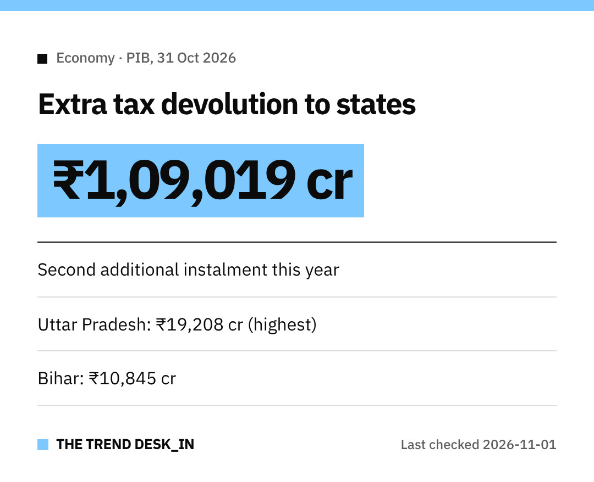

Here's a quick explainer on a big money transfer from the Centre to the states.

On **31 October 2026**, the Union Government released an **additional tax devolution instalment of ₹1,09,019 crore** to State Governments.
This is **on top of the regular monthly devolution**.

## Why now?
The Finance Ministry says the release is in view of the **upcoming festive season**.
It's meant to help states **speed up capital spending** and fund **development and welfare** expenditure.

This is the **second additional instalment** in this financial year.

## What is tax devolution, simply?
It's the states' share of central taxes that the Centre passes on to them.
States then use it for their own spending plans.

## State-wise amounts (₹ crore)

| State | Amount |
|---|---|
| Andhra Pradesh | 4,597 |
| Arunachal Pradesh | 1,476 |
| Assam | 3,552 |
| Bihar | 10,845 |
| Chhattisgarh | 3,602 |
| Goa | 398 |
| Gujarat | 4,094 |
| Haryana | 1,484 |
| Himachal Pradesh | 996 |
| Jharkhand | 3,660 |
| Karnataka | 4,504 |
| Keralam | 2,597 |
| Madhya Pradesh | 8,010 |
| Maharashtra | 7,022 |
| Manipur | 682 |
| Meghalaya | 688 |
| Mizoram | 615 |
| Nagaland | 524 |
| Odisha | 4,819 |
| Punjab | 2,176 |
| Rajasthan | 6,460 |
| Sikkim | 365 |
| Tamil Nadu | 4,466 |
| Telangana | 2,370 |
| Tripura | 699 |
| Uttar Pradesh | 19,208 |
| Uttarakhand | 1,244 |
| West Bengal | 7,866 |

## Top five at a glance
- **Uttar Pradesh:** ₹19,208 crore
- **Bihar:** ₹10,845 crore
- **Madhya Pradesh:** ₹8,010 crore
- **West Bengal:** ₹7,866 crore
- **Maharashtra:** ₹7,022 crore

Find your state in the table above.
