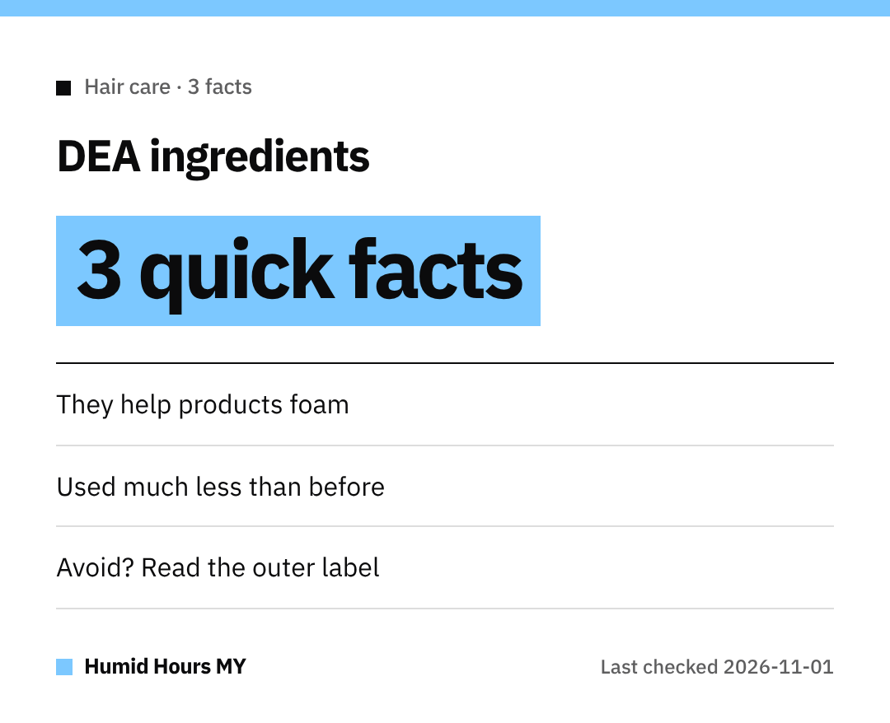

Hi everyone!
Here are three quick facts about **DEA-related ingredients**, straight from the US FDA.

## 1. They help with foam and texture
DEA and related ingredients are used as **emulsifiers or foaming agents**, or to **adjust pH**.

## 2. They're used less now
Based on information filed with the FDA, they appear to be used **much less frequently** than in **1998**, when an animal study raised questions.
That study **didn't establish a cancer link in humans**.

## 3. The FDA isn't raising alarms
The FDA says there's currently **no reason for consumers to be alarmed**.

## Want to avoid them anyway?
Read the **ingredient statement** on the outer label for names such as:

- Cocamide DEA / Cocamide MEA
- Lauramide DEA
- Myristamide DEA
- Oleamide DEA
- Linoleamide MEA / Stearamide MEA
- DEA-Cetyl Phosphate / DEA Oleth-3 Phosphate
- TEA-Lauryl Sulfate / Triethanolamine

Take care!
