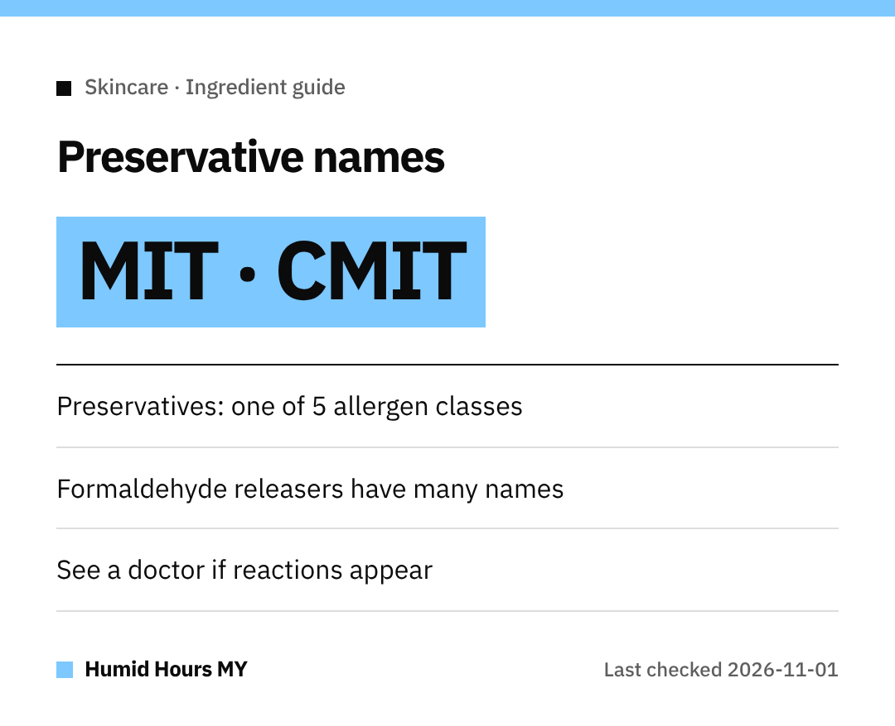

Hi everyone!
Preservatives keep products from spoiling, which matters in our weather.
But they're also one of the five allergen classes the US FDA highlights.

## Names on the label
- Methylisothiazolinone (**MIT**)
- Methylchloroisothiazolinone (**CMIT**)
- Formaldehyde-releasing ingredients such as **DMDM hydantoin**, **diazolidinyl urea**, **imidazolidinyl urea**, **quaternium-15** and **bronopol**

The FDA also lists **sodium hydroxymethylglycinate** among formaldehyde-releasing ingredients.

## The other four classes
Besides preservatives, common cosmetic allergens fall under **natural rubber, fragrances, dyes and metals**.

## What a reaction can look like
The FDA says reactions most often appear as **itchy, red rashes**.
They can also include **hives, flaking or peeling skin**, or facial swelling.

## Next steps
- Check the **ingredient list** before buying.
- If you suspect a reaction, consult a **healthcare professional** and tell them which product you used.

Take care!
