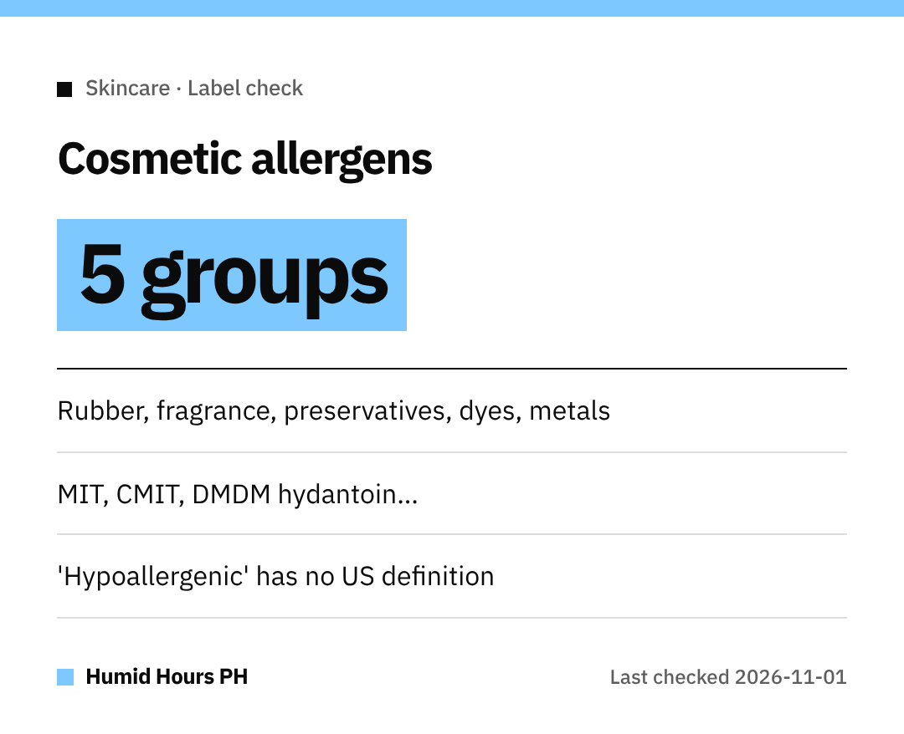

Hi, mga ka-Humid!
New lotion, then an itchy red rash?
The US FDA has a list that can help you read labels before you buy.

## The five groups
The FDA says most allergic reactions to cosmetics come from substances in five classes:
**natural rubber, fragrances, preservatives, dyes and metals**.

Reactions most often show up as **itchy, red rashes**, called allergic contact dermatitis.

## Preservative names to spot
- Methylisothiazolinone (**MIT**)
- Methylchloroisothiazolinone (**CMIT**)
- Formaldehyde-releasing ingredients such as **DMDM hydantoin**, **diazolidinyl urea**, **imidazolidinyl urea**, **quaternium-15** and **bronopol**

## Labels can only tell you so much
Terms like **"hypoallergenic," "fragrance-free"** and **"for sensitive skin"** have **no federal standard or definition** in the US.
Some ingredients can also be listed simply as **"fragrance" or "perfume."**

## What you can do
- Read the **ingredient list** and skip what you know you react to.
- Still unsure? **Contact the manufacturer** on the label.
- Follow the **directions**, including any patch test the label asks for.
- If you think you're reacting, see a **healthcare professional**.

Stay comfy, mga ka-Humid!
