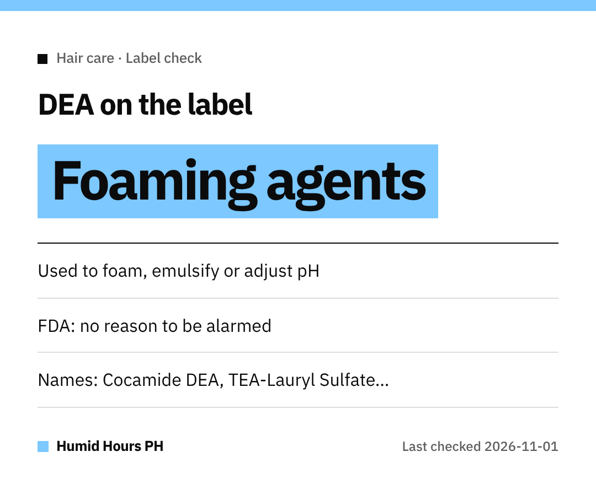

Hi, mga ka-Humid!
Love a shampoo that lathers up nicely?
That foam might come from **DEA** ingredients. Here's what the US FDA says about them.

## What DEA ingredients do
Diethanolamine (DEA) and related ingredients work as **emulsifiers or foaming agents**, or to **adjust a product's pH**.

## Why people ask about them
A **1998** National Toxicology Program study in **lab animals** raised questions.
The FDA notes that study **did not establish a link** between DEA and cancer risk in humans.

## The FDA's view
The FDA says there is currently **no reason for consumers to be alarmed** by these ingredients in cosmetics.
It also notes they appear to be used **much less often** now than back then.

## If you'd rather avoid them
Check the ingredient list for names like:

- Cocamide DEA / Cocamide MEA
- Lauramide DEA
- Myristamide DEA
- Oleamide DEA
- Linoleamide MEA / Stearamide MEA
- DEA-Cetyl Phosphate / DEA Oleth-3 Phosphate
- TEA-Lauryl Sulfate / Triethanolamine

Happy hair days, mga ka-Humid!
