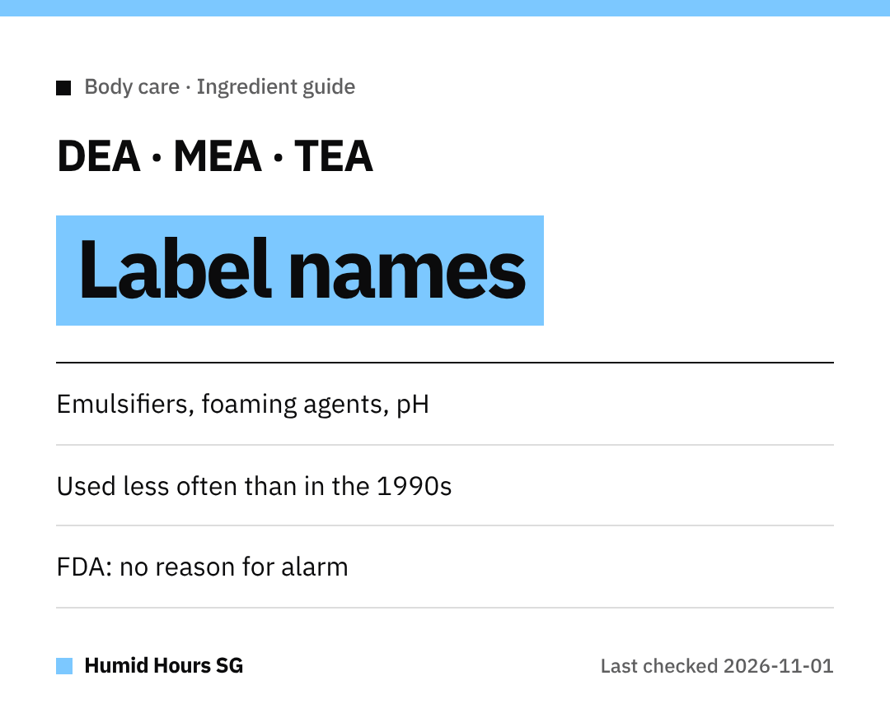

Hello Singapore!
Spotted "Cocamide DEA" or "TEA-Lauryl Sulfate" on a body wash and wondered what it is?
Here's a quick explainer from the US FDA.

## The job they do
DEA and DEA-related ingredients act as **emulsifiers, foaming agents** or **pH adjusters** in cosmetics.

## The background
In **1998**, an NTP study linked topical DEA and some related ingredients with cancer in **laboratory animals**.
It **did not establish a link to cancer risk in humans**.

Since then, filings with the FDA suggest these ingredients are used **much less frequently**.

## Where the FDA stands
The FDA says there's **no reason for consumers to be alarmed** right now.
If it finds a health hazard, it says it will advise industry and the public.

## Names to scan for
- Cocamide DEA / Cocamide MEA
- Lauramide DEA
- Myristamide DEA
- Oleamide DEA
- Linoleamide MEA / Stearamide MEA
- DEA-Cetyl Phosphate / DEA Oleth-3 Phosphate
- TEA-Lauryl Sulfate / Triethanolamine

Prefer to skip them? The ingredient list on the outer label is where to look.

Happy shopping!
