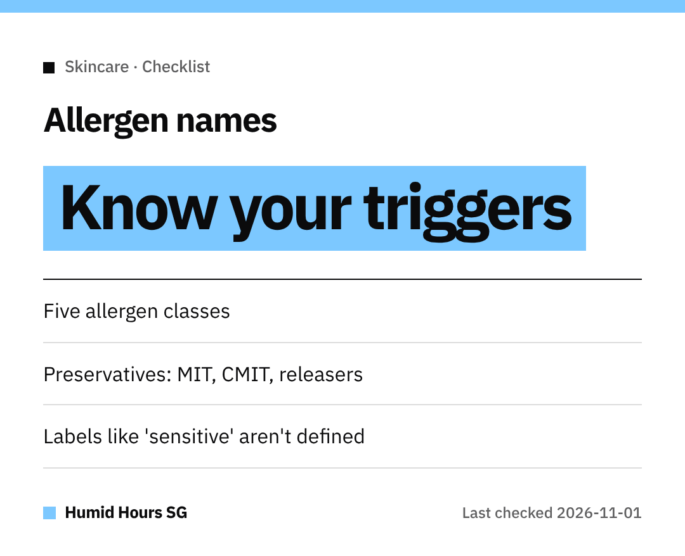

Hello Singapore!
If your skin flares up easily, a good ingredient checklist saves a lot of trial and error.
Here's one based on the US FDA's guidance.

## Step 1: know the five classes
The FDA groups common cosmetic allergens into **natural rubber, fragrances, preservatives, dyes and metals**.
For metals, it names **nickel and gold**. For dyes, **p-phenylenediamine (PPD)** and **coal-tar**.

## Step 2: learn the preservative names
- Methylisothiazolinone (**MIT**)
- Methylchloroisothiazolinone (**CMIT**)
- Formaldehyde-releasing ingredients such as **DMDM hydantoin**, **diazolidinyl urea**, **imidazolidinyl urea**, **quaternium-15** and **bronopol**

## Step 3: don't rely on front-label claims
"Hypoallergenic," "fragrance-free" and "for sensitive skin" **aren't defined by any federal standard** in the US.
Read the **back label**, not just the front.

## Step 4: ask, then act
- Questions about an ingredient? **Contact the manufacturer.**
- Think you're reacting? See a **healthcare professional**, since sensitivity can get **more severe over time**.

Happy (and itch-free) shopping!
