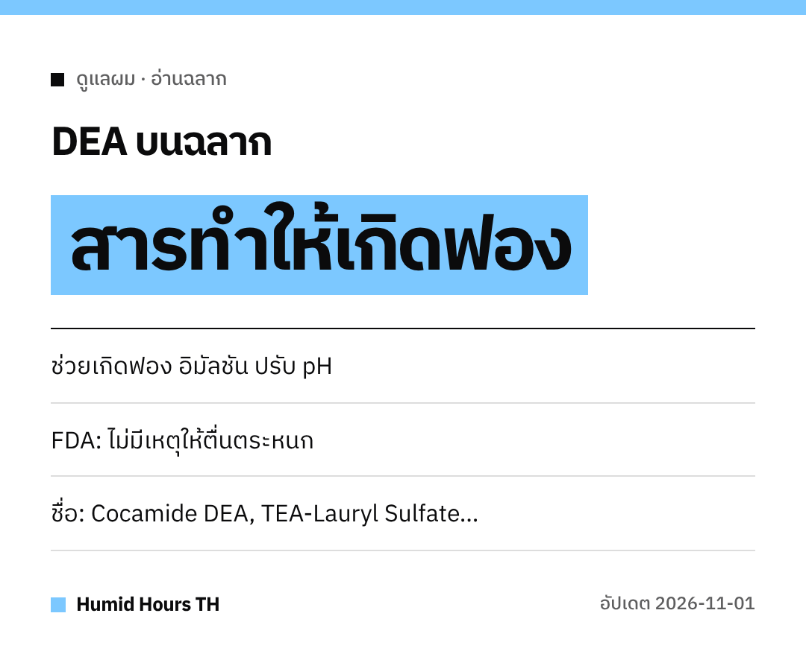

สวัสดีค่ะทุกคน!
ชอบแชมพูฟองเยอะไหมคะ
ฟองนั้นอาจมาจากสาร **DEA** มาดูที่ FDA สหรัฐฯ บอกกันค่ะ

## DEA มีหน้าที่อะไร
Diethanolamine (DEA) และสารที่เกี่ยวข้องใช้เป็น **อิมัลซิไฟเออร์ สารทำให้เกิดฟอง** หรือ **ปรับค่า pH**

## ทำไมถึงมีคำถาม
งานวิจัยของ NTP ปี **1998** ใน **สัตว์ทดลอง** ทำให้เกิดคำถาม
แต่งานวิจัยนั้น **ไม่ได้ยืนยันความเชื่อมโยง** ระหว่าง DEA กับความเสี่ยงมะเร็งในคน

## FDA สหรัฐฯ ว่าอย่างไร
FDA ระบุว่าตอนนี้ **ไม่มีเหตุให้ผู้บริโภคต้องตื่นตระหนก**
และดูเหมือนว่าใช้ **น้อยลงมาก** เมื่อเทียบกับก่อน

## อยากเลี่ยง ดูชื่อเหล่านี้
- Cocamide DEA / Cocamide MEA
- Lauramide DEA
- Myristamide DEA
- Oleamide DEA
- Linoleamide MEA / Stearamide MEA
- DEA-Cetyl Phosphate / DEA Oleth-3 Phosphate
- TEA-Lauryl Sulfate / Triethanolamine

ช้อปอย่างฉลาดนะคะ!
