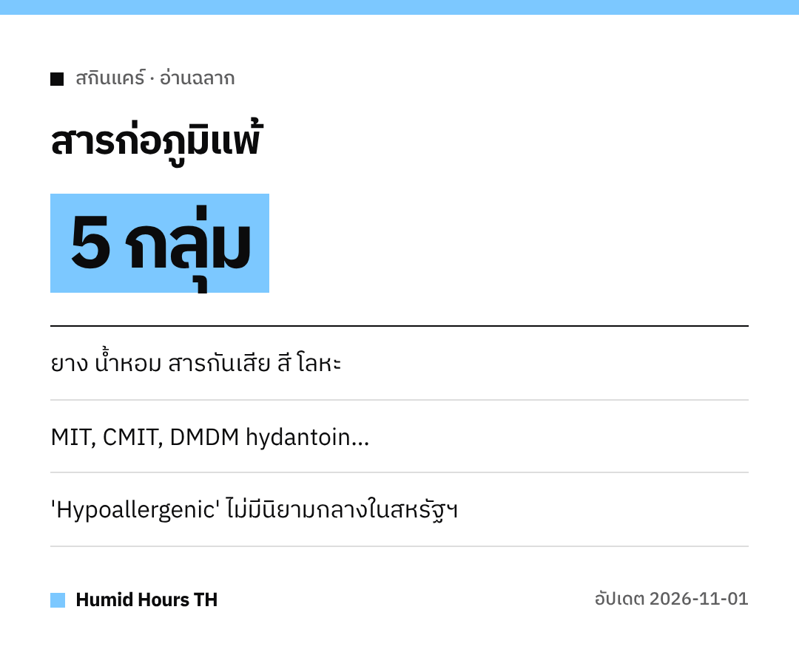

สวัสดีค่ะทุกคน!
เปลี่ยนโลชั่นใหม่แล้วผิวคัน แดง?
FDA สหรัฐฯ มีรายการที่ช่วยให้อ่านฉลากได้ดีขึ้นก่อนซื้อค่ะ

## 5 กลุ่มที่พบบ่อย
FDA สหรัฐฯ ระบุว่าอาการแพ้จากเครื่องสำอางส่วนใหญ่มาจาก 5 กลุ่ม
**ยางธรรมชาติ น้ำหอม สารกันเสีย สี และโลหะ**

อาการที่พบบ่อยที่สุดคือ **ผื่นแดงคัน** (ผิวหนังอักเสบจากการสัมผัสสารก่อภูมิแพ้)

## ชื่อสารกันเสียที่ควรสังเกต
- Methylisothiazolinone (**MIT**)
- Methylchloroisothiazolinone (**CMIT**)
- สารที่ปล่อยฟอร์มาลดีไฮด์ เช่น **DMDM hydantoin**, **diazolidinyl urea**, **imidazolidinyl urea**, **quaternium-15**, **bronopol**

## ฉลากบอกได้ไม่หมด
คำว่า **"hypoallergenic", "fragrance-free", "สำหรับผิวแพ้ง่าย"** **ไม่มีมาตรฐานหรือนิยามระดับรัฐบาลกลาง** ในสหรัฐฯ
บางส่วนผสมอาจเขียนรวมว่า **"fragrance"** หรือ **"perfume"** เท่านั้น

## ทำอะไรได้บ้าง
- อ่าน **รายการส่วนผสม** แล้วเลี่ยงสารที่รู้ว่าแพ้
- ยังสงสัย **ติดต่อผู้ผลิต** ตามที่ระบุบนฉลาก
- ถ้าสงสัยว่าแพ้ ให้ปรึกษา **บุคลากรทางการแพทย์**

ผิวสบายนะคะ!
