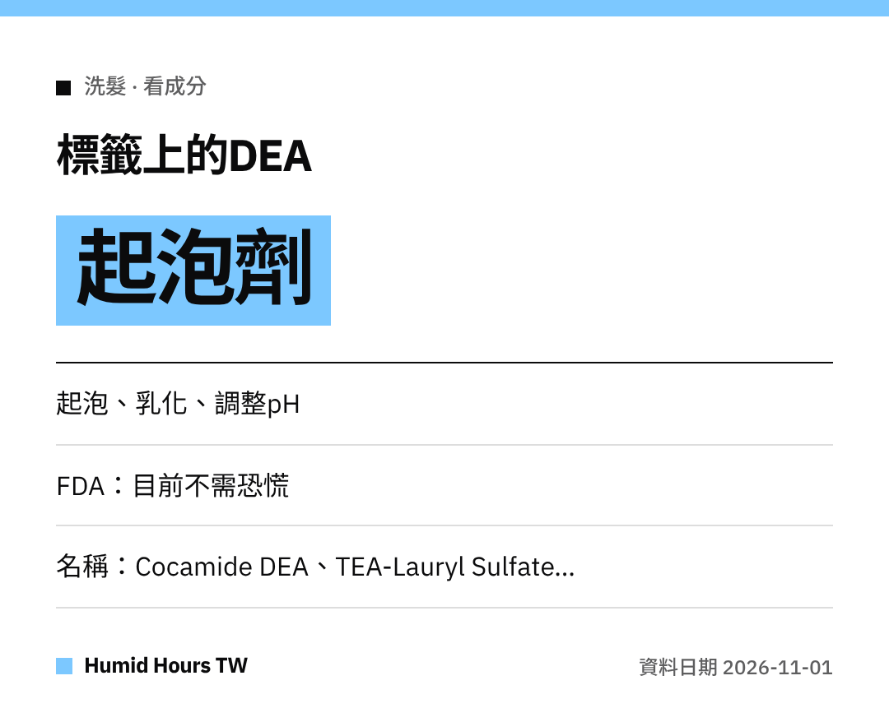

哈囉大家～
喜歡泡泡很多的洗髮精嗎？
那些泡泡可能來自**DEA**類成分。來看美國FDA怎麼說。

## DEA的用途
二乙醇胺（DEA）及相關成分在化妝品中當作**乳化劑、起泡劑**，或用來**調整pH**。

## 為什麼有人擔心
美國國家毒理學計畫（NTP）**1998**年的**動物實驗**引起疑問。
但該研究**並未證實**DEA與人類罹癌風險有關。

## 美國FDA的看法
FDA表示目前**沒有理由讓消費者恐慌**。
而且這類成分的使用量似乎**比過去少很多**。

## 想避開的話看這些名稱
- Cocamide DEA / Cocamide MEA
- Lauramide DEA
- Myristamide DEA
- Oleamide DEA
- Linoleamide MEA / Stearamide MEA
- DEA-Cetyl Phosphate / DEA Oleth-3 Phosphate
- TEA-Lauryl Sulfate / Triethanolamine

大家都要聰明買喔！
