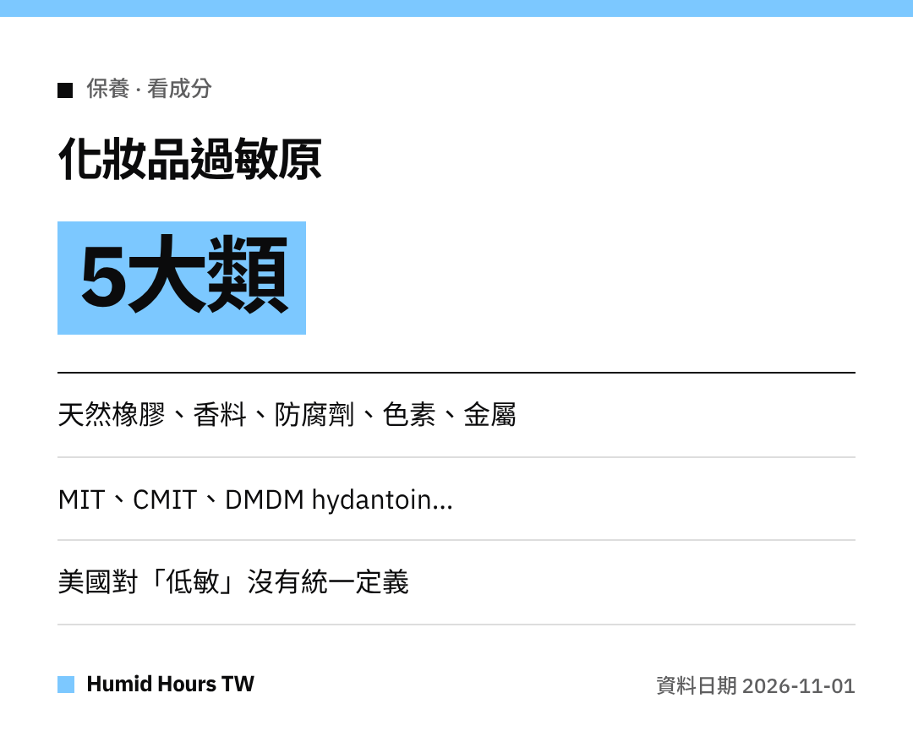

哈囉大家～
換了新乳液就起紅疹、發癢？
美國FDA整理了一份清單，讓我們買之前更會看標籤。

## 常見的5大類
美國FDA指出，化妝品引起的過敏反應大多來自5類物質：
**天然橡膠、香料、防腐劑、色素和金屬**。

最常見的是**發癢的紅疹**（過敏性接觸性皮膚炎）。

## 要注意的防腐劑名稱
- Methylisothiazolinone（**MIT**）
- Methylchloroisothiazolinone（**CMIT**）
- 會釋放甲醛的成分，例如 **DMDM hydantoin**、**diazolidinyl urea**、**imidazolidinyl urea**、**quaternium-15**、**bronopol**

## 標籤說不完的事
「**hypoallergenic（低敏）**」「**fragrance-free（無香料）**」「**敏感肌適用**」在美國**沒有聯邦標準或定義**。
有些成分也可能只標成「**fragrance**」或「**perfume**」。

## 可以怎麼做
- 看**成分表**，避開自己知道會過敏的成分。
- 還有疑問就**聯絡標籤上的製造商**。
- 懷疑過敏時，請諮詢**醫療人員**。

大家都要好好保養喔！
