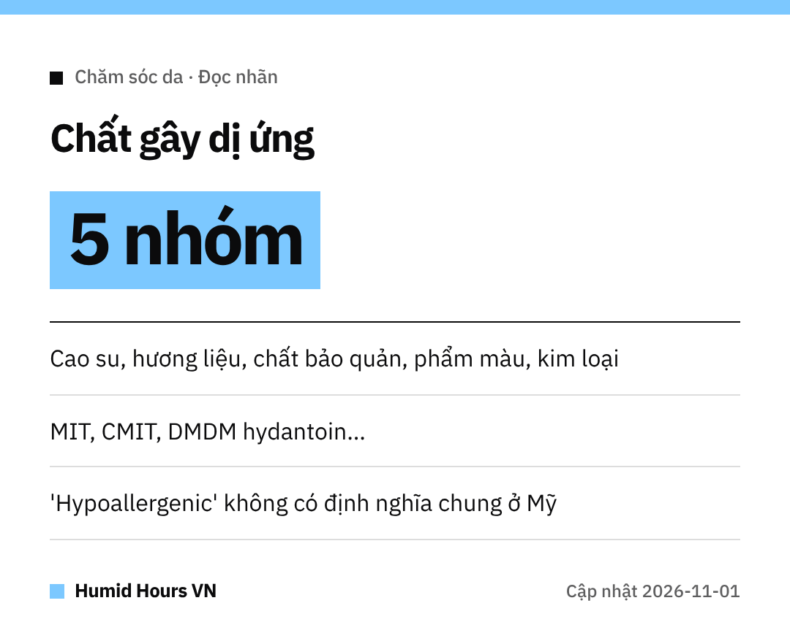

Chào cả nhà!
Đổi kem dưỡng mới rồi bị ngứa, nổi mẩn đỏ?
FDA Mỹ có danh sách giúp mình đọc nhãn kỹ hơn trước khi mua.

## 5 nhóm thường gặp
Theo FDA Mỹ, phần lớn phản ứng dị ứng do mỹ phẩm đến từ 5 nhóm:
**cao su tự nhiên, hương liệu, chất bảo quản, phẩm màu và kim loại**.

Phản ứng hay gặp nhất là **nổi mẩn đỏ, ngứa** (viêm da tiếp xúc dị ứng).

## Tên chất bảo quản cần để ý
- Methylisothiazolinone (**MIT**)
- Methylchloroisothiazolinone (**CMIT**)
- Chất giải phóng formaldehyde như **DMDM hydantoin**, **diazolidinyl urea**, **imidazolidinyl urea**, **quaternium-15**, **bronopol**

## Nhãn chỉ nói được một phần
Các chữ **"hypoallergenic", "fragrance-free", "cho da nhạy cảm"** **không có tiêu chuẩn hay định nghĩa liên bang** ở Mỹ.
Một số thành phần cũng có thể chỉ ghi chung là **"fragrance"** hay **"perfume"**.

## Nên làm gì
- Đọc **bảng thành phần**, tránh chất mình biết là bị dị ứng.
- Còn thắc mắc thì **liên hệ nhà sản xuất** trên nhãn.
- Nghi bị dị ứng thì gặp **nhân viên y tế**.

Chúc cả nhà da khỏe!
