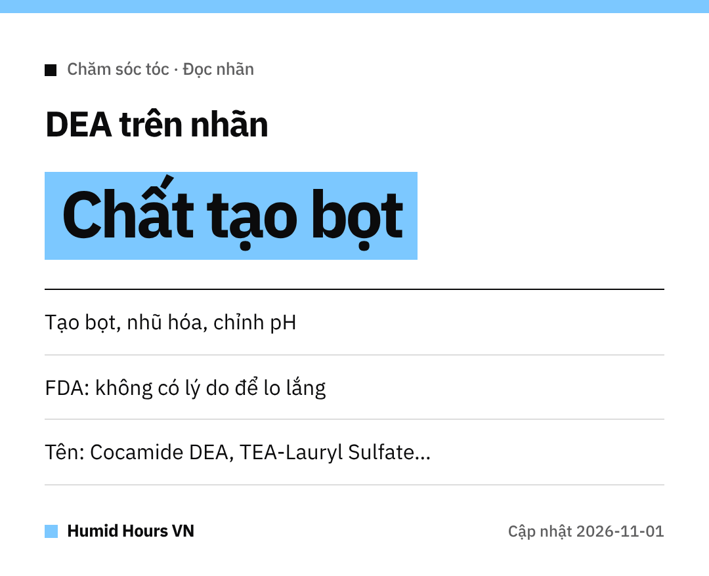

Chào cả nhà!
Thích dầu gội nhiều bọt?
Lớp bọt đó có thể đến từ thành phần **DEA**. Xem FDA Mỹ nói gì nhé.

## DEA dùng để làm gì?
Diethanolamine (DEA) và các chất liên quan đóng vai trò **chất nhũ hóa, tạo bọt** hoặc **điều chỉnh độ pH**.

## Vì sao có người lo ngại?
Một nghiên cứu năm **1998** của NTP trên **động vật thí nghiệm** từng đặt ra câu hỏi.
Nghiên cứu này **chưa xác lập mối liên hệ** giữa DEA và nguy cơ ung thư ở người.

## FDA Mỹ nói gì?
FDA cho rằng hiện **không có lý do để người tiêu dùng lo lắng**.
Các chất này cũng có vẻ được dùng **ít hơn nhiều** so với trước.

## Muốn tránh thì xem tên nào?
- Cocamide DEA / Cocamide MEA
- Lauramide DEA
- Myristamide DEA
- Oleamide DEA
- Linoleamide MEA / Stearamide MEA
- DEA-Cetyl Phosphate / DEA Oleth-3 Phosphate
- TEA-Lauryl Sulfate / Triethanolamine

Chúc cả nhà tóc khỏe!
