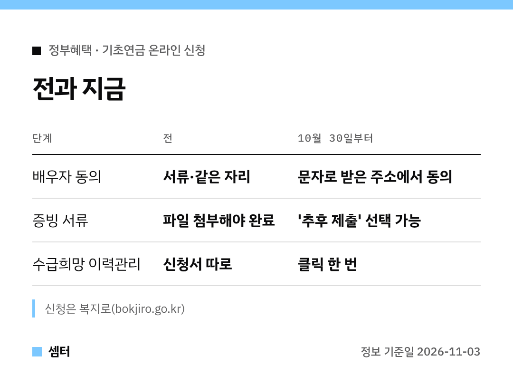

온라인으로 신청하다가 "배우자 동의가 안 돼서" 결국 주민센터 가신 분 많을 거예요ㅎㅎ
지난해 온라인으로 신청한 사람이 100명 중 3명꼴이었대요.

그 걸림돌이 **10월 30일부터** 바뀌었어요 🙂

## 신청 순서대로 볼게요
### 1. 금융정보 제공 동의
기초연금은 부부의 소득·재산을 같이 봐서, 두 분 모두 동의가 필요해요.
이제 배우자 쪽은 **문자로 받은 누리집 주소**에서 동의하면 돼요.

두 분이 같은 자리에 없어도 되니까, 따로 사시거나 바쁘셔도 괜찮아요!

### 2. 증빙 서류
임대차계약서처럼 따로 내야 하는 서류가 있죠.
지금 당장 없으면 **'추후 제출'**을 골라 신청부터 끝내면 돼요.

나중에 온라인이나 방문으로 내면 된대요.

### 3. 수급희망 이력관리
혹시 이번에 떨어지더라도, 5년간 매년 2번 다시 살펴보고 받을 수 있게 되면 신청한 걸로 봐 주는 제도예요.
이제 신청 화면에서 **클릭 한 번**으로 같이 신청돼요.

## 이렇게 바뀐 이유
온라인 신청을 중간에 포기한 2,467건을 보니, 동의 문제가 37.2%, 서류 작성이 38%였대요.
딱 이 두 군데를 고친 거예요.

신청은 복지로(www.bokjiro.go.kr)에서 하시면 돼요~

다들 부모님 기초연금 꼭 챙겨 드리시구! 오늘도 좋은 하루 보내세요~ㅎㅎ
