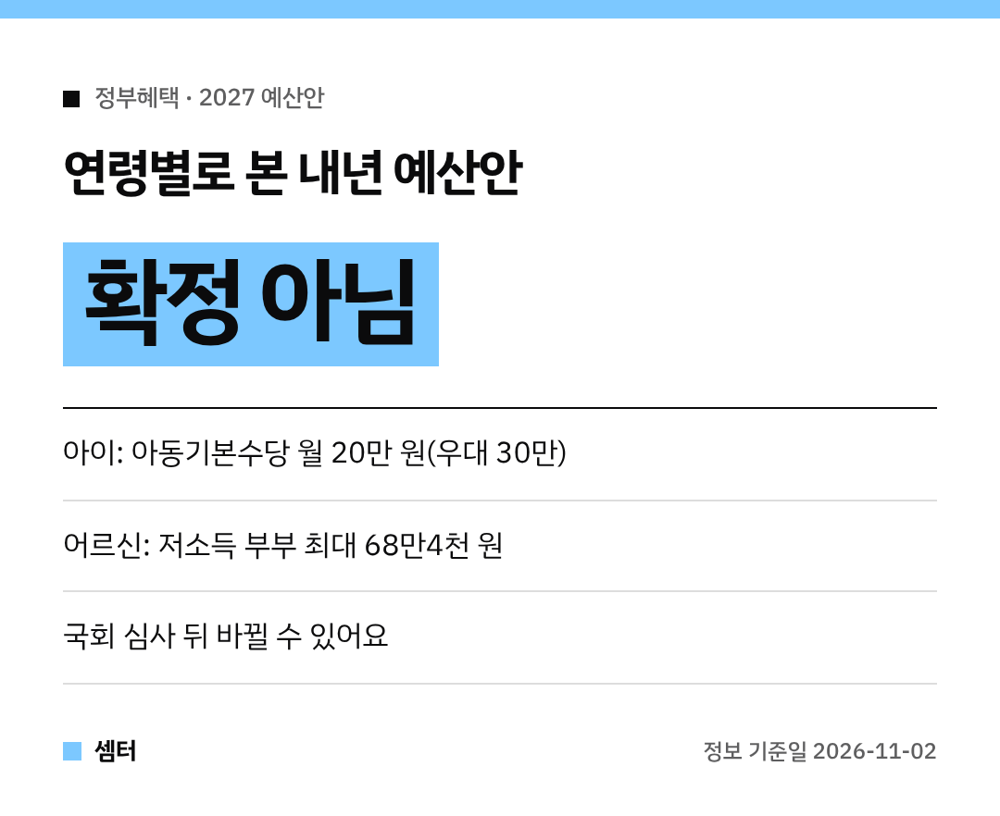

내년 나라 살림 계획, 11월 2일 시정연설로 윤곽이 나왔어요~
숫자가 워낙 많아서 **누구에게 뭐가 해당되는지** 기준으로 나눠 봤답니다 🙂

## 시작 전에: 아직 정해진 건 아니에요
정부가 국회에 낸 **예산안**이에요.
국회 심사에서 금액이 늘거나 줄 수 있어서 **확정 아님**으로 봐 주세요!
그래도 방향은 미리 알아 두면 좋겠죠?

## 아이 키우는 집이라면
- **혼인지원금 100만 원**(신혼부부)
- **아이맞이지원금 최대 2000만 원**(출산 시)
- **아동기본수당** 월 기본 **20만 원**, 우대지역 **30만 원** — 아동수당·부모급여를 하나로 합친 형태
- **우리아이자립펀드** 새로 만들기

아동기본수당은 **아동수당법을 고쳐야** 시행할 수 있대요.
그래서 언제, 누구부터인지는 법 개정 소식을 같이 봐야 해요.

## 청년이라면
청년 예산이 **43조3000억 원**으로 잡혔어요.
올해보다 53.5% 많은 규모래요!
일경험·훈련·구직 지원도 넓힌대요 😊

## 어르신이라면
저소득 어르신은 기초연금이 **월 최대 3만 원** 더 붙어요.
부부가 함께 받을 때 깎이던 비율도 절반으로 줄여서, 저소득 부부는 **56만 원 → 최대 68만4000원**이 된대요.
노인일자리는 118만 개로 늘어나고요.
소득이 적은 부부 어르신이라면 체감이 꽤 클 것 같아요.

## 장애인 가구라면
장애인연금을 받는 사람이 **35만 명 → 61만 명**으로 넓어져요.

## 형편이 어려운 가구라면
복지 대상을 정하는 기준 중위소득이 6.7% 오르는 게 핵심이에요.
60여 개 복지사업 기준이 함께 움직이고, **4인 가구 생계급여는 월 221만8000원**까지 올라요.

게다가 주요 급여는 신청 안 해도 자격이 되면 자동으로 받게 바꾼대요.

## 사장님·지역 소식
코로나19 피해 소상공인 등의 장기연체 빚 **5조4000억 원** 규모를 특별조정하는 데 **5000억 원**을 넣는대요.

지역 쪽으로는 국토대전환·지방주도성장에 **33조 원**, 수도권 중앙행정기관 **44개**는 세종으로 단계적으로 옮긴다고 했어요.

국회에서 최종 확정되면 항목별 신청 방법이 나오니, 그때 또 알려 드릴게요~

다들 우리 집 해당 항목 체크해 두시구! 오늘도 좋은 하루 보내세요~ㅎㅎ
