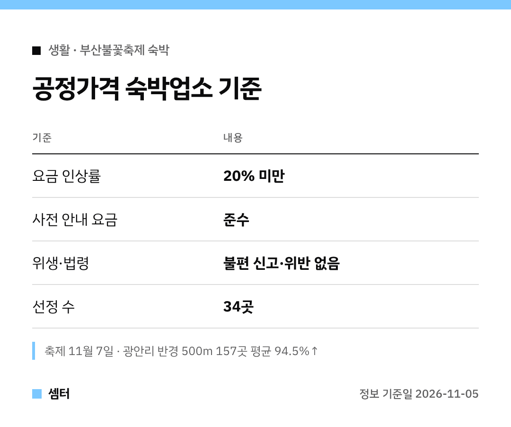

불꽃축제 날 광안리 숙소, 가격 보고 놀라셨죠?ㅎㅎ
부산시가 **바가지 덜한 숙소 34곳**을 따로 골라 공개했어요 🙂

## 얼마나 비싸졌길래?
축제가 열리는 **11월 7일**, 광안리 반경 500m 안 숙박업소 157곳을 조사해 보니 평균 **94.5%**가 올랐대요.
200% 넘게 올린 곳도 15곳이나 있었어요.

## 공정가격 숙소는 어떻게 골랐어요?
세 가지를 다 만족해야 해요.
1. 요금 인상률 20% 미만
2. 사전에 안내한 요금 그대로
3. 위생 불편 신고나 법령 위반 없음

## 어디서 보나요?
부산시가 공개한 명단이니, 부산시 관광 안내에서 먼저 확인해 보세요!

## 예약 전 체크포인트
- 최종 결제 금액과 취소·환불 규정 확인
- 예약 후 업소 쪽에서 취소를 요청하면 이유를 꼭 확인

다들 즐거운 불꽃 구경 하시구! 오늘도 좋은 하루 보내세요~ㅎㅎ
