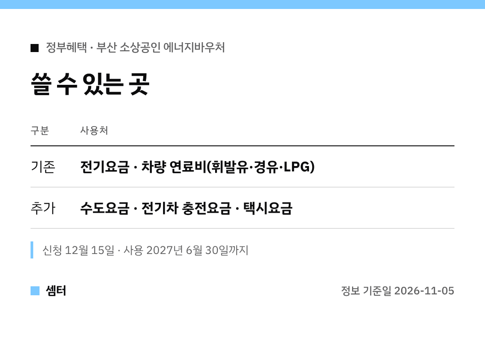

"부산 에너지바우처 6일이 마감이라던데 못 했어요ㅠ" 하시는 사장님들 계시죠?
걱정 마세요, **12월 15일까지** 늘어났어요 🙂

## 체크 1. 나도 대상일까?
- 부산시에 사업장이 있는 소상공인
- 연매출 3억 원 이하

## 체크 2. 얼마 받아요?
1인당 20만 원이에요.
동백전 정책지원금으로 들어와요.

## 체크 3. 언제까지?
- 신청: 11월 6일 → **12월 15일**
- 사용: 올해 말 → **2027년 6월 30일**

반년 넘게 여유 있게 쓸 수 있게 된 거예요!

## 체크 4. 어디에 써요?
원래는 전기요금, 휘발유·경유·LPG 같은 차량 연료비였는데요.
이제 **수도요금, 전기차 충전요금, 택시요금**도 돼요.

전기차 충전요금 결제는 11월 9일부터 시작할 계획이래요.

부산시 5일 발표 기준이니, 신청 방법은 부산시·동백전 안내를 꼭 함께 확인하세요~

다들 든든하게 챙기시구! 오늘도 좋은 하루 보내세요~ㅎㅎ
