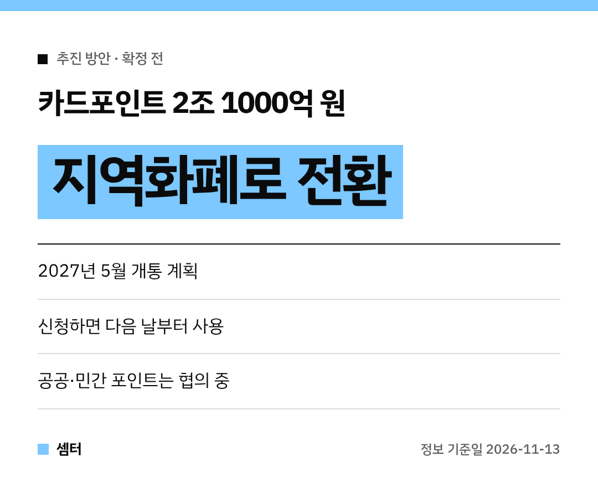

혹시 내 카드에 포인트가 얼마나 쌓였는지 아세요? 🙂
안 쓰고 잠든 카드포인트가 모두 **2조 1000억 원**이래요.

정부가 이걸 **지역화폐로 바꿔 쓰게 하는 방안**을 내놨어요.
개통은 **2027년 5월 계획**이라 아직은 준비 단계예요!

## 한 줄 요약
카드포인트 → 지역화폐로 전환 → 전통시장·골목상권에서 사용.

## 이용 순서(개통 후 예정)
1. 어카운트인포 또는 지역화폐 앱 접속
2. 보유 카드포인트 조회
3. 원하는 금액만큼 전환 신청
4. **다음 날부터** 지역화폐로 사용

어카운트인포가 카드사와 지역화폐 운영사 사이를 이어 주는 중계 역할을 한대요.

## 확정된 것 vs 협의 중인 것
- 확정 방향: **카드포인트**부터 도입, 2027년 5월 개통 계획
- 협의 중: KTX 마일리지·탄소중립포인트 같은 공공기관 포인트
- 단계적 확대 목표: 유통·항공 등 민간 업계 포인트(자발적 참여 유도)

협의 중인 건 바뀔 수 있으니 나중에 다시 확인해 주세요!

## 어디서 나온 방안?
11월 13일 제17회 국가정책조정회의에 보고됐어요.
국무조정실이 중심이 되고 행정안전부·금융위원회·금융결제원이 함께 만들었대요.
궁금한 점은 국무조정실 재정금융정책관실(044-200-2184)에 물어보면 돼요.

알뜰한 연말 되시구! 오늘도 좋은 하루 보내세요~ㅎㅎ
