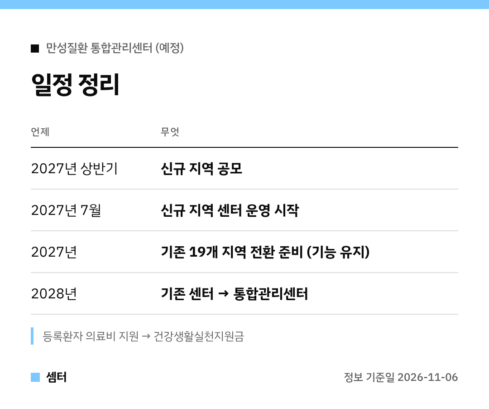

고혈압·당뇨병 관리 받는 가족이 있다면 일정만이라도 알아 두면 좋아요 🙂

## 한 줄 요약
고혈압·당뇨병 등록교육센터가 '만성질환 통합관리센터'로 바뀔 예정이에요.

## 기존 19개 지역
2027년은 준비 기간이라 이름도, 교육·상담·알림도 그대로예요.
연말 평가를 거쳐 2028년부터 통합관리센터로 운영할 계획이래요.

## 새로 생기는 지역
2027년 상반기에 공모로 지역을 골라요.
뽑힌 곳은 2027년 7월부터 모든 연령 환자에게 교육·상담·알림을 제공할 예정이에요.

## 꼭 챙길 것
기존 등록환자의 의료비 지원은 건강생활실천지원금으로 바뀌어요.
지자체와 센터가 전환 절차를 안내해 준다니, 연락 오면 놓치지 마세요!

관리 질환도 이상지질혈증 등으로 늘어난대요.

다들 꾸준히 건강 관리하시구! 오늘도 좋은 하루 보내세요~ㅎㅎ
