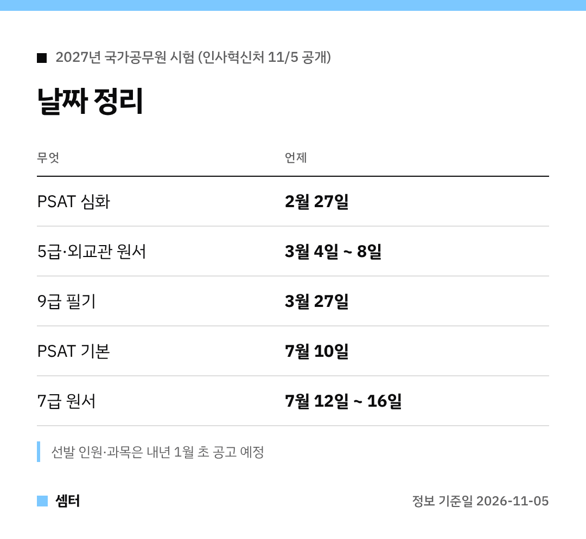

"내년 공무원 시험 언제 봐요?" 궁금하셨던 분들께 반가운 소식이에요 🙂

인사처가 내년 시험 계획을 미리 공개했어요.
가장 큰 변화는 PSAT가 따로 떼어 치르는 검정시험이 됐다는 거예요.

## PSAT, 뭐가 달라져요?
PSAT는 '심화'와 '기본' 두 가지예요.
심화 성적은 5급·외교관 1차, 기본 성적은 7급 1차를 대신해요.

시험 날은 심화 2월 27일, 기본 7월 10일이에요.
응시 수수료는 따로 없대요!

## 꼭 체크할 것 1: 원서 따로
PSAT만 보면 끝이 아니에요.
5급·외교관은 3월 4~8일, 7급은 7월 12~16일에 채용시험 원서를 또 내야 해요.

## 꼭 체크할 것 2: 성적 마감
영어·외국어·한국사 대체 성적은 이제 원서 마감일까지 나온 것만 인정해요.
5급·외교관은 3월 8일, 7급은 7월 16일이 기준이에요.

예전처럼 1차 시험 전날까지 기다릴 수 없으니 미리 따 두세요~
다만 7급 외무영사직렬 외국어 선택과목은 예전처럼 2차 시험 예정일 전날까지예요.

## 배점도 바뀌어요
어려운 문제는 점수를 더, 쉬운 문제는 덜 줘요.
심화는 3.5·2.5·1.5점, 기본은 5·4·3점이에요.

## 9급은?
9급 필기는 3월 27일이에요.
한국사는 한국사능력검정시험 3급, 또는 그보다 높은 등급이면 대신할 수 있어요.

자세한 선발 인원은 1월 초 공고를 기다려 주세요!

다들 합격까지 파이팅하시구! 오늘도 좋은 하루 보내세요~ㅎㅎ
