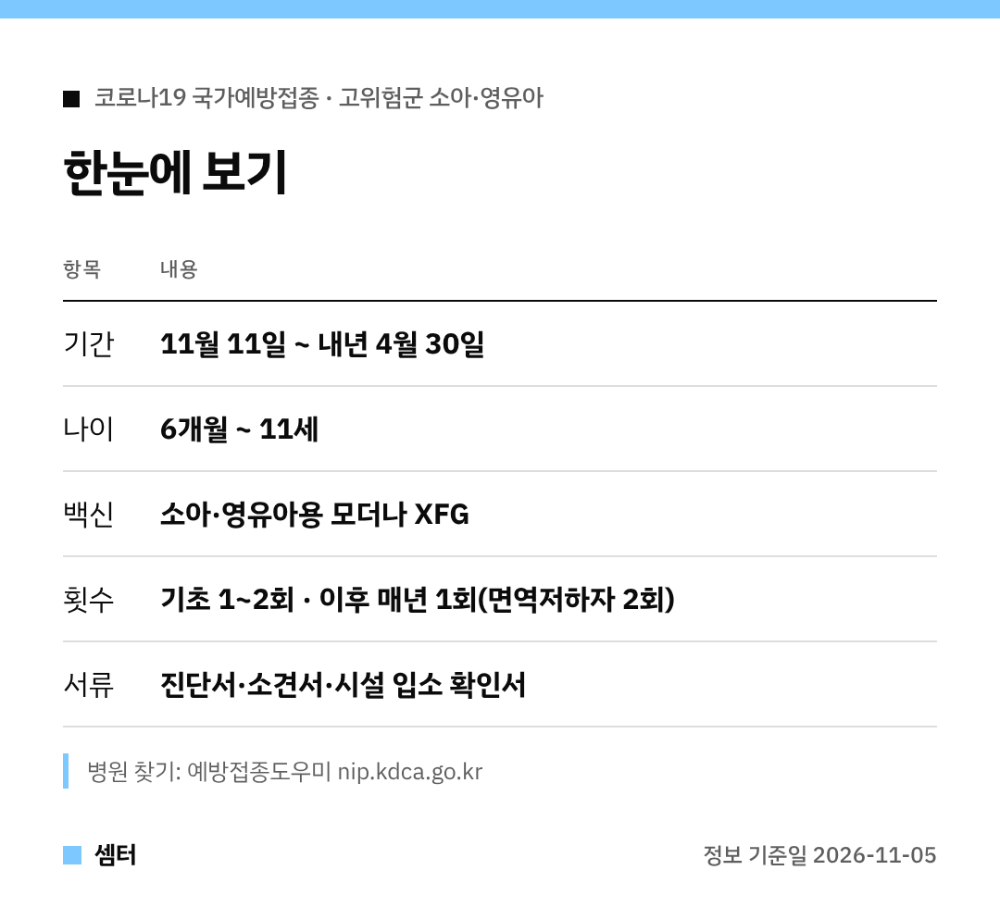

"우리 애는 면역이 약한데 코로나 백신 못 맞나요?" 하셨던 분들께 반가운 소식이에요 🙂

질병관리청이 고위험군 아이 코로나19 국가예방접종을 **11월 11일**부터 시작한대요.

## 왜 이제야 생긴 거예요?
지금까지는 12세 미만이 맞을 수 있는 국내 허가 백신이 없었어요.
그래서 식약처가 10월 28일 소아·영유아용 모더나 XFG 백신을 긴급 도입했답니다.

## 누가 맞을 수 있어요?
6개월부터 11세까지 아이 중 고위험군이에요.
면역저하자, 그리고 요양병원·요양시설·정신건강증진시설·장애인 및 노숙인 생활시설에 입원하거나 입소한 아이가 해당돼요.

## 횟수는 아이마다 달라요
기초접종이 아직이면 1~2회로 먼저 채워요.
기초를 마친 아이는 해마다 1회, 면역저하자는 해마다 2회 맞아요.

과거 접종 이력에 따라 달라지니 의사 선생님과 꼭 상담하세요!

## 병원 갈 때 체크
- 대상임을 보여 줄 서류: 진단서, 소견서, 시설 입소 확인서 등
- 의사가 면역저하자로 보면 서류 없이도 가능
- 맞고 나서 20~30분은 병원에서 대기

## 접종 병원 찾기
예방접종도우미(nip.kdca.go.kr) → '예방접종관리' → '위탁의료기관 찾기' 순서로 들어가면 돼요.
문의는 질병관리청 예방접종관리과 043-719-8365예요.

접종 기간은 내년 4월 30일까지라 여유는 있지만, 겨울 오기 전에 맞혀 두면 마음이 놓이겠죠~

다들 감기 조심하시구! 오늘도 좋은 하루 보내세요~ㅎㅎ
