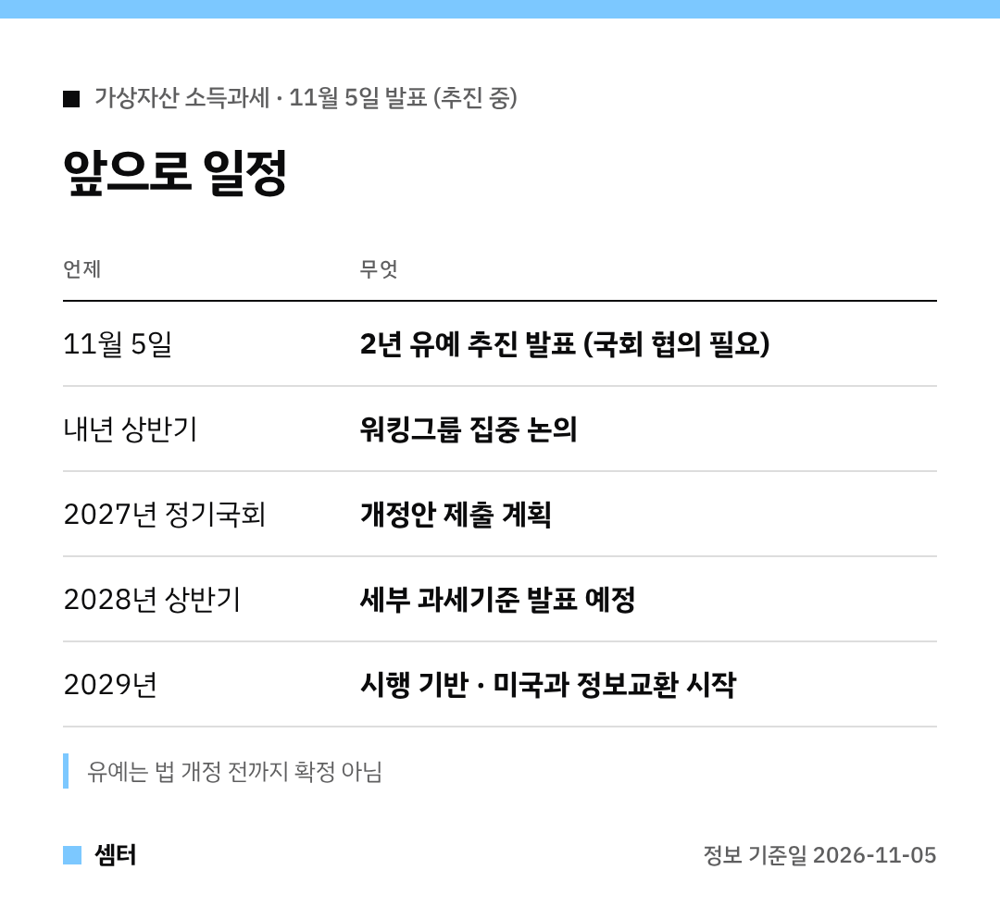

"코인 세금 결국 내년부터 내는 건가요?" 궁금하셨던 분들 위해 정리해 봤어요 🙂

정부가 **2년 유예 카드**를 꺼냈어요.
하지만 국회를 통과해야 해서 아직은 **추진 단계**예요.

## 발표 핵심
11월 5일 재정경제부 브리핑에서 나온 얘기예요.
내년 시행 예정이던 가상자산 소득과세를 2년간 미루는 방안을 국회와 협의한대요.

## 유예 이유 두 가지
첫째, 해외 거래 과세 자료예요.
미국과의 정보교환(CARF)이 2029년부터라서, 그 전엔 해외 거래 파악이 어렵대요.

둘째, 디지털자산법이에요.
이 법이 생기면 업계 기반이 크게 달라지니 준비 기간이 더 필요하다는 판단이에요.

## 투자자에게 반가운 부분
손실을 3년간 이월해서 공제하는 제도도 같이 추진해요.
올해 손해 본 걸 다음 해 이익에서 빼 주는 식이라, 변동성 큰 코인엔 꼭 필요했던 제도죠~

## 이후 흐름
워킹그룹이 내년 상반기까지 논의하고, 2027년 정기국회에 개정안을 낼 계획이래요.
세부 과세기준은 2028년 상반기에 나올 예정이에요.

결론은, 아직 아무것도 확정된 건 없다는 것!
국회 논의 결과가 나오면 다시 정리해 드릴게요.

다들 차분하게 투자하시구! 오늘도 좋은 하루 보내세요~ㅎㅎ
