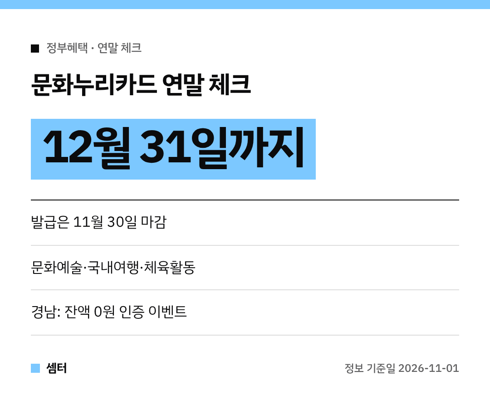

연말 되면 꼭 나오는 질문이 있죠~
"문화누리카드 남은 돈 어떻게 돼요?" 🙂

답부터 드리면, **12월 31일까지 쓰지 않으면 끝**이에요.
그리고 아직 카드를 안 만들었다면 **11월 30일**이 발급 마감이랍니다!

## 체크리스트 ①: 나는 대상일까?
6세 이상(2020년 12월 31일 이전 출생)의 **기초생활수급자·차상위계층**이면 대상이에요.
한 사람당 **1년에 15만 원**을 지원받아요.

## 체크리스트 ②: 카드 발급했나?
아직이라면 서둘러야 해요.
기한 안에 발급하지 않은 지원금은 **국고로 반납돼서 소멸**돼요.

신청 경로는 네 가지예요.
- 행정복지센터
- 누리집 www.mnuri.kr
- 모바일 앱
- ARS 전화

## 체크리스트 ③: 잔액 남았나?
문화예술, 국내여행, 체육활동에 쓸 수 있어요.
**12월 31일**까지 가맹점에서 써야 해요.

## 경남 도민 보너스
경남문화예술진흥원이 **11월 한 달 동안** '잔액 0원 인증 이벤트'를 열어요.
다 쓰고 잔액 화면을 인증하면 추첨으로 **올리브영 모바일 교환권**을 준대요.
참여는 포스터의 신청서 링크나 QR코드로 하면 돼요.

다들 연말 문화생활 즐겁게 하시구! 좋은 하루 보내세요~ㅎㅎ
