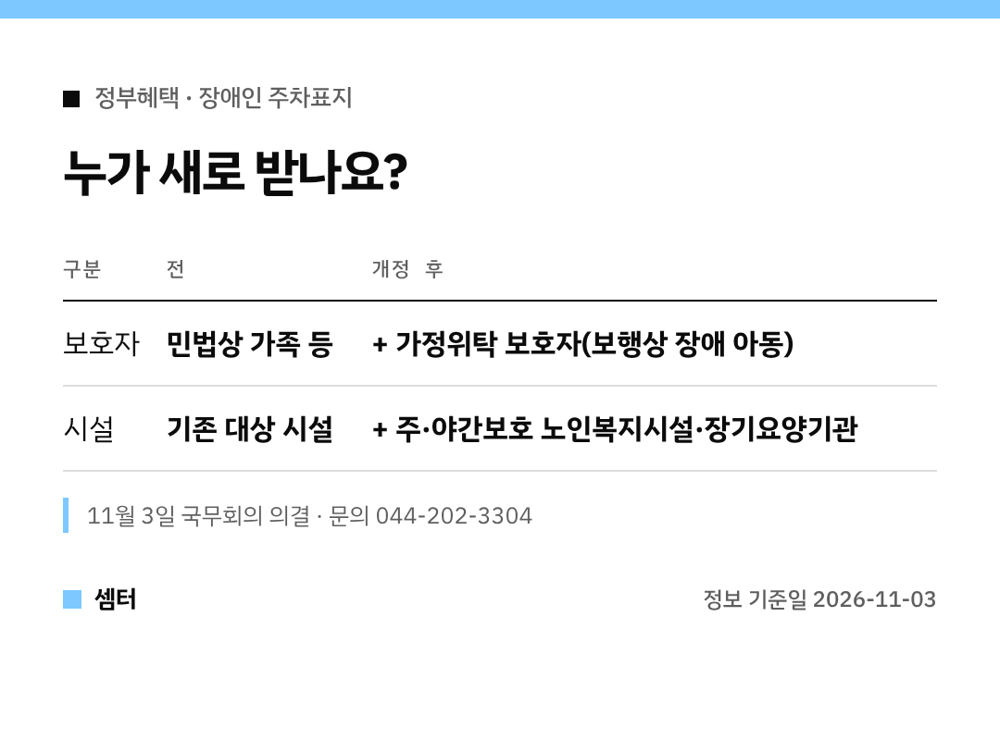

"위탁으로 키우는 아이도 장애가 있는데, 주차표지는 왜 안 되지?"
이런 고민 하셨던 분들께 반가운 소식이에요 🙂

## 한 줄 요약
장애인전용주차구역 주차표지를 받을 수 있는 **보호자와 시설이 늘었어요**.
11월 3일 국무회의에서 편의증진법 시행령 개정안이 의결됐대요.

## 새로 대상이 된 보호자
보행상 장애가 있는 아동을 **가정위탁으로 돌보는 보호자**예요.

지금까지 보호자용 표지는 민법상 가족 등만 받을 수 있었어요.
그래서 위탁 보호자는 아이를 태우고 다녀도 표지를 못 받았던 거죠.

## 새로 대상이 된 시설
어르신 **주·야간보호서비스**를 하는 곳이에요.
노인복지법상 재가노인복지시설과 노인장기요양보험법상 장기요양기관 둘 다 들어가요.

부모님이 다니시는 센터도 주차표지를 받을 수 있게 되는 거라, 어르신 오가는 길이 한결 편해질 수 있어요!

## 같이 바뀐 것
노인의료복지시설과 경로당은 장애인 화장실에 영유아용 거치대를 꼭 두지 않아도 되게 바뀌어요.

## 언제부터, 어디에 물어봐요?
이번엔 국무회의 의결 단계라, 실제 발급 시작은 공포 뒤 안내를 확인해야 해요.
문의는 보건복지부 장애인권익지원과(044-202-3304)예요.

다들 꼭 필요한 분들이 편하게 쓰시길 바라요! 오늘도 좋은 하루 보내세요~ㅎㅎ
