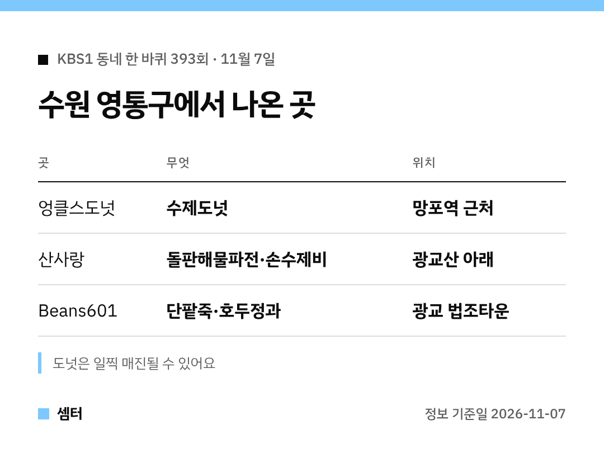

"동네 한 바퀴에 나온 수원 도넛집 이름이 뭐였더라?" 하신 분들 여기 있어요 🙂

## 도넛집
망포역 근처 '엉클스도넛'이에요.
부부가 하루 정해진 양만 만들어서 금방 동난대요!

[📍 엉클스도넛 지도](https://map.naver.com/p/search/%EC%88%98%EC%9B%90%20%EB%A7%9D%ED%8F%AC%20%EC%97%89%ED%81%B4%EC%8A%A4%EB%8F%84%EB%84%9B)

## 파전집
광교산 아래 '산사랑'이에요.
돌판에 지글지글 해물파전, 손수제비가 나왔어요.

[📍 산사랑 지도](https://map.naver.com/p/search/%EA%B4%91%EA%B5%90%EC%82%B0%20%EC%82%B0%EC%82%AC%EB%9E%91)

## 팥 카페
광교 법조타운 카페거리 'Beans601'이에요.
모녀가 만드는 단팥죽이랑 호두정과가 소개됐어요~

[📍 Beans601 지도](https://map.naver.com/p/search/%EA%B4%91%EA%B5%90%20Beans601)

## 덤
광교호수공원, 영흥수목원, 영통동 500년 느티나무도 함께 나왔어요.

다들 든든한 주말 보내시구! 오늘도 좋은 하루 보내세요~ㅎㅎ
