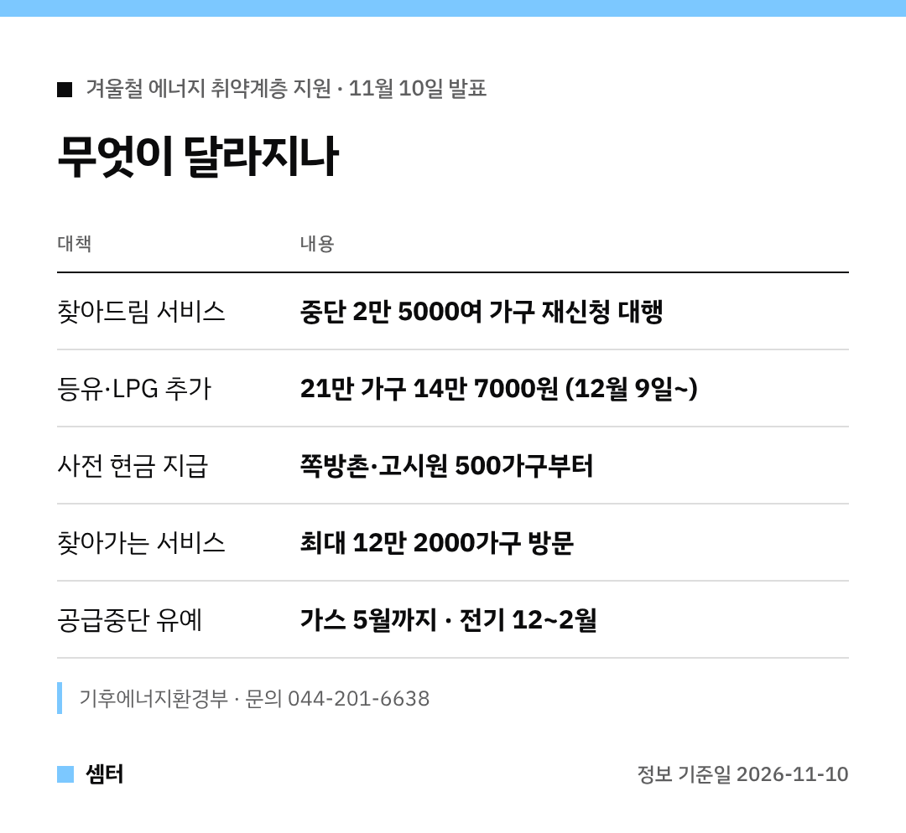

에너지바우처 받는 집이라면 이번 발표 꼭 챙겨 보세요 🙂
바뀌는 걸 다섯 가지로 묶어 봤어요.

## 1. 바우처가 끊겼다면
이사·세대원 변경으로 지원이 멈춘 집이 대상이에요.
상담원이 연락하고 공무원이 재신청을 대신 처리해요.

행정복지센터를 안 가도 돼요.
내년 3월까지 중단된 2만 5000여 가구가 대상이래요.

## 2. 등유·LPG로 난방한다면
기름값 부담이 큰 21만 가구에 14만 7000원어치를 더 줘요.
평균 36만 7000원이던 지원이 51만 4000원이 돼요.

지급은 12월 9일부터 국민행복카드로요.

## 3. 쪽방촌·고시원에 산다면
월세에 난방비가 묶여 있어 바우처를 못 쓰는 집이에요.
겨울 전에 현금으로 먼저 받을 수 있어요.

이번 달 미리 신청한 500가구부터 시작해요.

## 4. 바우처를 다 못 썼다면
집배원·사회복지사가 집으로 찾아가요.
올해는 절반도 못 쓴 집까지 넓혀서 최대 12만 2000가구를 방문한대요.

작년엔 5만 9000가구를 찾아가 99억 원어치를 쓰게 도왔대요 😊

## 5. 요금이 밀렸다면
도시가스는 5월까지 끊지 않고, 전기는 12월부터 내년 2월까지 사용 제한을 풀어요.
작년 바우처 기간에 밀린 전기요금은 바우처 잔액으로 낼 수 있어요.

다들 따뜻한 겨울 보내시구! 오늘도 좋은 하루 보내세요~ㅎㅎ
