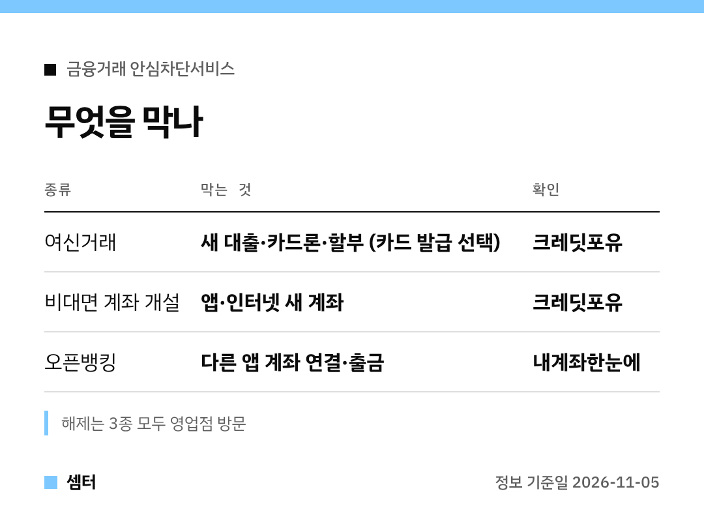

개인정보 유출 문자 받고 불안하셨던 분들께 꼭 알려 드리고 싶은 서비스예요 🙂

비밀번호 바꾸는 것만으론 마음이 안 놓이잖아요.
'금융거래 안심차단'을 걸어 두면 내 이름으로 새 대출이나 통장 만드는 걸 막을 수 있어요.

## 세 가지는 따로따로예요
대출 막기와 계좌 개설 막기는 별개 기능이에요.
필요한 걸 골라서 걸면 돼요.

- 여신거래: 신용대출, 카드론, 할부금융, 담보대출을 새로 못 하게
- 비대면 계좌 개설: 앱이나 인터넷으로 새 통장 못 만들게
- 오픈뱅킹: 고른 금융회사 계좌를 다른 앱에서 못 쓰게

## 오픈뱅킹 차단 전 체크
이걸 걸면 간편결제 앱이나 지역사랑상품권 앱 결제가 막힐 수 있어요.
자주 쓰는 앱이 어느 계좌에 연결돼 있는지 먼저 보고 정하세요~

## 신청 · 확인 · 해제
신청은 은행 창구(신분증 지참), 은행 앱, 내계좌한눈에 중 편한 곳에서 해요.
걸어 둔 상태는 크레딧포유(여신·비대면 계좌)와 내계좌한눈에(오픈뱅킹)에서 볼 수 있어요.

풀 때는 영업점에 가야 하니 참고하세요!

## 한 단계 더
개인정보가 정말 새어 나갔다면 금감원 파인에서 '개인정보노출자'로 등록할 수 있어요.
내 이름으로 기억 안 나는 계좌나 대출이 있는지도 내계좌한눈에서 한번 훑어보세요.

그리고 문자 속 링크는 절대 누르지 말고, 공식 앱이나 대표번호로 확인하기!

다들 안전하게 금융 생활하시구! 오늘도 좋은 하루 보내세요~ㅎㅎ
