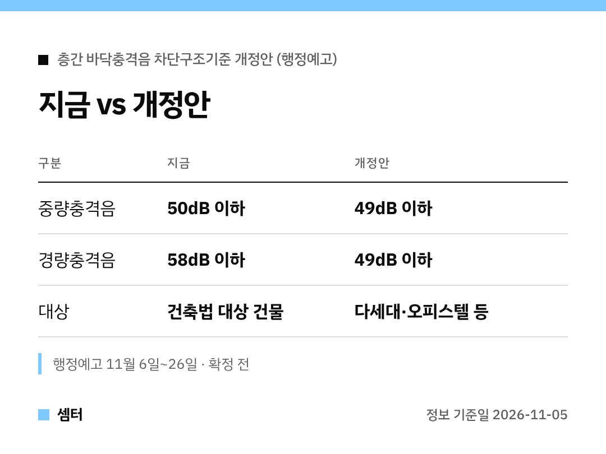

오피스텔 살면서 옆집, 윗집 소리 때문에 고생해 보신 분들 손~ 🙋

국토부가 이런 건물의 층간소음 기준을 손본대요.
11월 6일부터 26일까지 행정예고하고, 그 뒤에 확정하는 순서예요.

## 어떤 건물 얘기예요?
주택법이 아니라 건축법을 따르는 건물이에요.
다세대주택, 오피스텔 같은 곳이죠.

그동안 아파트 같은 주택법 공동주택보다 바닥 기준이 느슨했어요.

## 숫자로 보면
쿵쿵 울리는 중량충격음은 50dB에서 49dB로 낮아져요.
톡톡 떨어지는 경량충격음은 58dB에서 49dB로 확 낮아지고요.

두 가지 모두 49dB 이하로 맞추는 거예요.

## 짓는 쪽은 어떻게?
새 기준에 맞는 표준바닥구조와 완충재 품질기준이 같이 생겨요.
성능시험을 받은 인정바닥구조를 써도 되고, 고시된 표준바닥구조를 써도 돼요.

시공관리 기준도 함께 손본대요.

## 한 가지 주의
바닥 시공 기준이라, 이미 지어진 집에 바로 적용되는 건 아니에요.
앞으로 오피스텔이나 빌라 새로 알아보실 때 체크 포인트로 기억해 두세요~

다들 꿀잠 주무시구! 오늘도 좋은 하루 보내세요~ㅎㅎ
