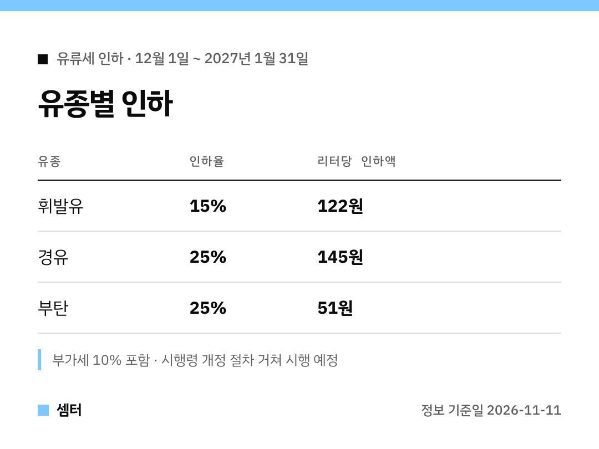

"유류세 인하 이번 달로 끝나는 거 아니었어?" 궁금하셨던 분들 🙂
결론부터 말하면 두 달 더 가요.

## 기간
12월 1일부터 2027년 1월 31일까지예요.
인하율은 바뀌지 않고 지금 수준 그대로예요.

## 탄력세율 변화
리터당 세금이 이렇게 내려간 상태가 이어져요.

- 휘발유 820원 → 698원
- 경유 581원 → 436원
- 부탄 203원 → 152원

## 경유가 더 많이 깎이는 이유
물류·산업용으로 꼭 써야 하는 연료라서예요.
부탄도 생계형 소형트럭에 많이 쓰여서 25%를 유지한대요.

## 확정까지 남은 단계
관련 시행령 두 개(교통·에너지·환경세법, 개별소비세법) 개정안을 국무회의에 올려 처리한 뒤 시행할 계획이에요.

이번 연장은 2021년 11월 시작된 인하 조치를 이어 가는 거예요 😊

다들 기름값 아끼시구! 오늘도 좋은 하루 보내세요~ㅎㅎ
