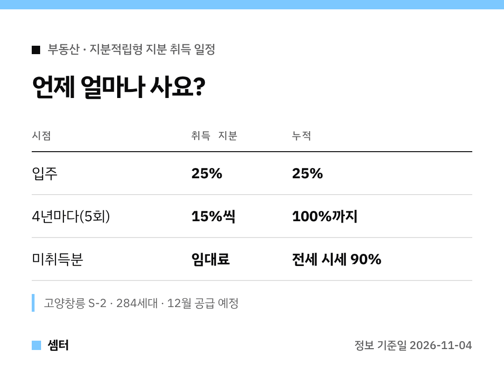

"지분적립형"이라는 말, 많이 들어 보셨죠?
드디어 **실제 첫 분양 단지**가 정해졌어요 🙂

## 첫 단지: 고양창릉 S-2블록
12월에 LH 고양창릉 S-2블록 1057세대 중 284세대가 지분적립형으로 나와요.
국토부가 11월 4일 발표했어요.

## 지분은 이렇게 사요
- 입주할 때: 분양가의 **25%**
- 그 뒤: **4년마다 15%씩, 모두 5번**
- 아직 안 산 지분: 주변 전세 시세의 **90%** 수준 임대료

형편이 어려우면 한 번에 최대 1년까지 취득을 늦출 수 있대요.

## 내 부담, 대략 계산해 보면
정부가 든 예시예요.
수도권 공공분양 평균 분양가 5억 1000만 원(전용 55㎡)이면 입주 때 **1억 2800만 원**이 필요해요.

주변 전세가 4억 원이라고 치면, 남은 지분 임대료는 보증금으로 2억 7000만 원 또는 월세로 월 79만 원이래요.
월세로 돌리면 "처음 1억 2800만 원 + 매달 79만 원" 구조가 되는 거죠!

## 아직 확정 아닌 것 두 가지
- **LTV 40%**: 적용되면 초기 자금이 7700만 원까지 줄지만, 지금은 검토 중이에요.
- **이익공유형Ⅱ**: 분양가 70%를 기금에서 빌리고 차익을 나누는 모델인데, 법 개정이 먼저 필요해요.

LH 내년 분양계획에도 이런 단지가 포함될 예정이라니 눈여겨보세요~

다들 꼼꼼하게 준비하시구! 오늘도 좋은 하루 보내세요~ㅎㅎ
