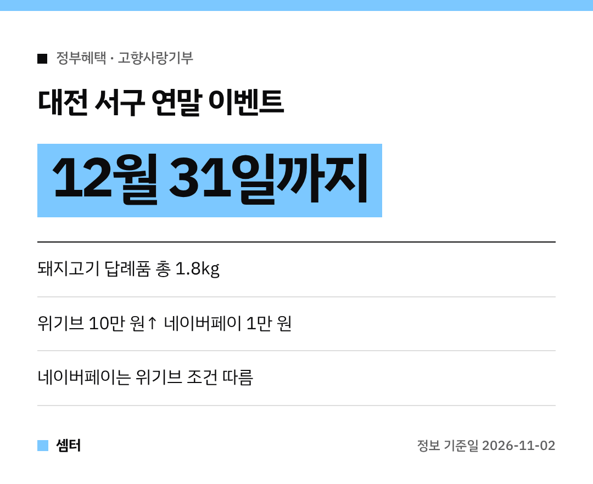

고향사랑기부, 연말에 몰아서 하시는 분들 많죠~?
지자체마다 연말 이벤트가 시작됐는데요, 이번엔 **대전 서구** 소식이에요 🙂

## 한눈에
| 혜택 | 내용 |
|---|---|
| 답례품 증량 | 돼지고기 1.2kg → **1.8kg** |
| 플랫폼 혜택 | 위기브 **10만 원 이상** 기부 시 네이버페이 **1만 원권** |
| 기간 | **12월 31일까지** |

## 돼지고기, 얼마나 더?
대상 답례품을 고르면 **0.6kg**을 더 준대요.
원래 1.2kg이던 게 **1.8kg**이 되는 거죠.

## 네이버페이 받으려면
**위기브**라는 민간 플랫폼을 통해 기부해야 해요.
그리고 네이버페이는 **위기브의 지급 조건**을 따른다고 하니, 기부 전에 조건을 꼭 보세요!

## 이건 알고 기부하세요
고향사랑기부는 **내 주소지가 아닌 지자체**에 하는 거예요.
대전 서구 주민이라면 다른 지역을 골라야 해요.

기부는 **고향사랑e음**이나 **위기브**에서 할 수 있어요.

다들 마음 따뜻한 연말 되시구! 오늘도 좋은 하루 보내세요~ㅎㅎ
