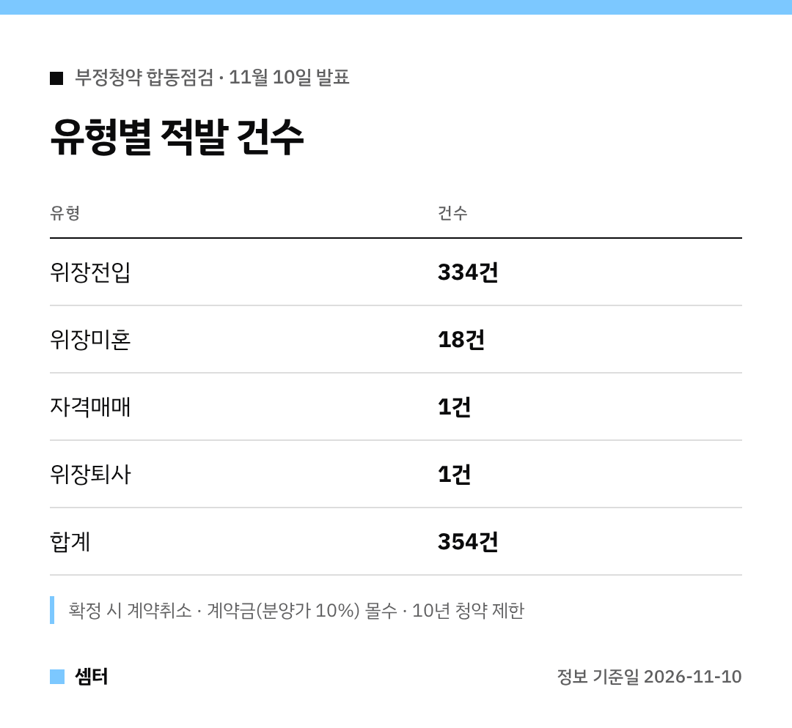

"부모님 주소만 잠깐 옮기면 되지 않을까?" 이런 생각 하시는 분 있다면 잠깐만요 🙂
정부 점검에서 딱 그런 사례들이 무더기로 걸렸어요.

## 점검 결과 한 줄 요약
서울 등 43개 단지 당첨자 2만 5000세대를 봤더니 의심사례가 354건 나왔어요.
작년 상반기 점검보다 대상은 적었지만 적발은 40.5% 늘었대요.

## 위장전입이 압도적
354건 가운데 334건이 위장전입이에요.
지역 거주 요건, 무주택 요건, 부양가족 가점을 노리고 주소만 옮긴 경우죠.

한 당첨자는 다른 지역에 사는 어머니와 장모를 자기 집으로 전입시켜 가점제로 서울 아파트에 당첨됐다가 걸렸대요.

## 위장미혼은 이런 경우
집이 있는 사람과 결혼식을 올리고 아이까지 키우면서, 혼인신고만 안 하고 무주택자로 청약한 사례예요.
이런 경우 18건이 나왔어요.

## 처벌 체크
| 조치 | 내용 |
|---|---|
| 형사처벌 | 3년 이하 징역 또는 3000만 원 이하 벌금 |
| 계약 | 취소 (주택 환수) |
| 계약금 | 분양가의 10% 몰수 |
| 청약 자격 | 10년 제한 |

적발된 건은 전부 수사의뢰 예정이에요.

## 단속은 계속돼요
경찰은 1·2차 부동산범죄 특별단속에서 2151명 송치, 16명 구속을 했어요.
3차 단속은 11월 1일 시작해서 내년 10월 31일까지예요 😊

다들 정정당당하게 내 집 마련하시구! 오늘도 좋은 하루 보내세요~ㅎㅎ
