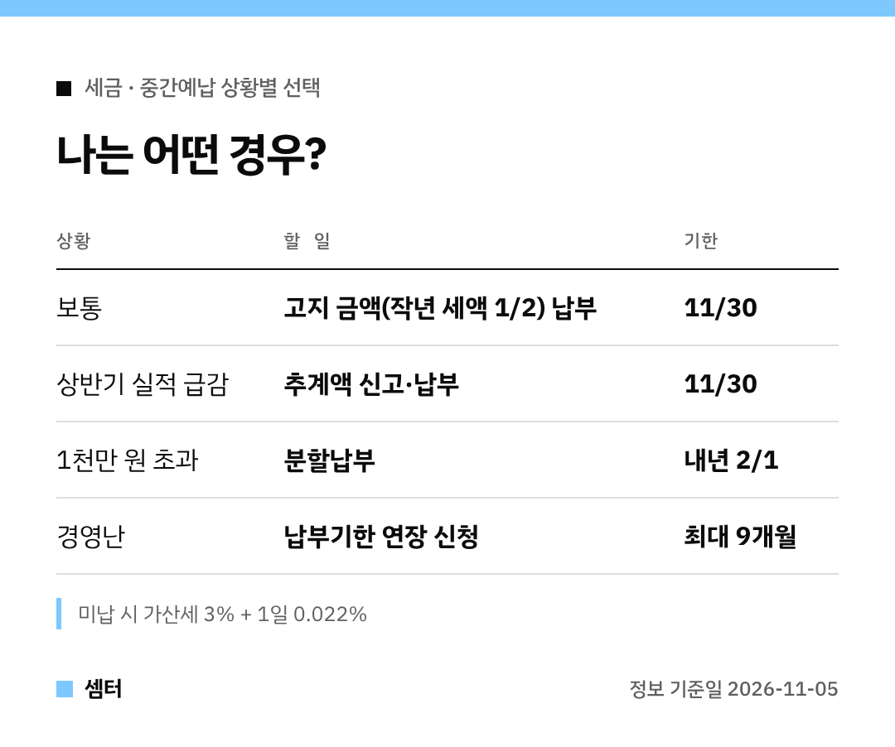

중간예납 고지서 받고 "이걸 그냥 다 내야 하나?" 고민되셨죠?
상황에 따라 고를 수 있는 길이 있어요 🙂

## 먼저, 중간예납이란
작년 종합소득세의 절반을 11월에 미리 내는 제도예요.
올해는 개인사업자 154만 명에게 11월 2일부터 고지서가 나가고 있어요.

## 선택 1. 그냥 낸다
제일 간단해요.
**11월 30일까지** 고지된 금액을 내면 끝이에요.

## 선택 2. 추계액으로 신고한다
올해 상반기 장사가 확 줄었다면 이쪽을 보세요.
상반기 실적으로 계산한 금액이 작년 세액의 30%보다 적으면, 그 금액으로 신고·납부할 수 있어요.

## 선택 3. 나눠 낸다
고지 금액이나 추계액이 1천만 원을 넘으면 일부를 **내년 2월 1일까지** 나눠 낼 수 있어요.
2천만 원 이하면 1천만 원 넘는 부분, 2천만 원 넘으면 절반까지예요.

## 선택 4. 미룬다
재해나 사업 부진으로 정말 어렵다면, 홈택스나 세무서에 신청해서 최대 9개월 늦출 수 있어요.

## 주의할 점
아무것도 안 하고 넘기면 가산세가 붙어요(3% + 하루 0.022%).
고지 금액이 50만 원 미만이면 애초에 고지서가 안 나와요.

다들 무사히 넘기시구! 오늘도 좋은 하루 보내세요~ㅎㅎ
